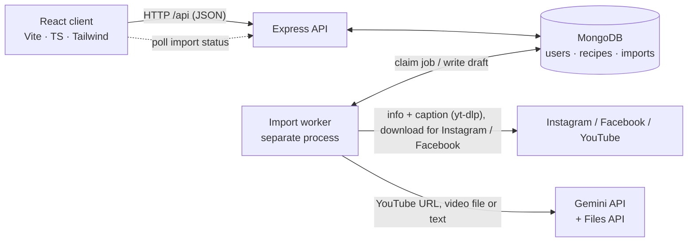
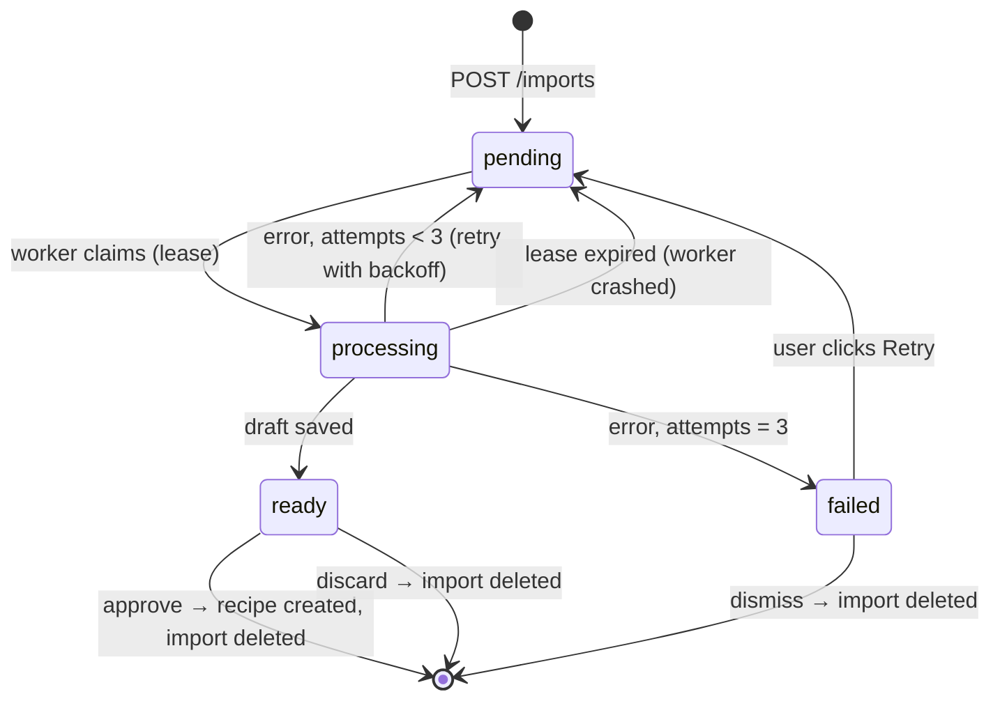

# Pinch — system design

> **Pinch** — pinch a recipe from a reel, cook it later.
> A learning project: system design first, then code that is simple enough to read line by line.

Status: **design agreed, 2026-10-29.** Changes to the design are made in this file.

---

## 1. Requirements

### Functional (v1)

1. **Import from a link.** The user pastes a link to an Instagram, Facebook or YouTube reel or
   video. The system turns it into a structured recipe.
2. **Fallback input.** If a link can't be read, the user can paste the caption text or upload
   screenshots instead.
3. **Draft and review.** An import produces a **draft**. Nothing is saved as a recipe until the
   user reviews, edits and approves it.
4. **Import status.** The user sees each import's progress (`waiting → fetching → analyzing →
   ready to review`) or a readable failure with **Retry**.
5. **Categorize.** The AI tags each recipe by cuisine, meal, diet, flavor and best fit.
6. **Nutrition.** An estimate per serving (calories, protein, carbs, fat), marked as an estimate.
7. **Manage.** Create a recipe by hand, edit it, delete it.
8. **Find.** Free-text search plus tag filters, newest first.
9. **Ownership.** Every recipe belongs to one user and only that user sees it.

### Placeholders (UI only, no backend in v1)

- **Share** — a button that says "coming soon".
- **Comments** — a section that says "coming soon". (When built: its own collection, never an
  array inside the recipe, because it grows without limit.)

### Later

Auth (see §8.3), share, comments, a WhatsApp bot or PWA share target, nutrition from a real
database, semantic search ("recipes like this one").

### Out of scope

Meal planning, shopping lists, scaling servings, Instagram/Facebook **stories** from a link
(they expire after 24h and are usually private; the screenshot fallback covers them).

### Non-functional

| Concern | Target |
|---|---|
| Scale | ~100 users × ~100 recipes (a POC) |
| Responsive | Phone first; works on tablet and desktop |
| Look and feel | Clean and friendly; it should feel finished |
| CRUD latency | < 300 ms |
| Import time | Typically < 60 s, always **asynchronous**: the UI never waits on it |
| Video length | ≤ 3 minutes (checked before downloading when the platform reports it; otherwise right after, see §4.1) |
| Reliability | A crash never loses an import or creates a duplicate recipe |
| Media | **Never stored.** Only text, plus a tiny thumbnail (§5) |
| Cost | Imports per user per day are capped (default 20) |
| Code | Simple and consistent above all — every line should be easy to read |

## 2. Back-of-envelope numbers

- Recipe text ≈ 5 KB, thumbnail ≈ 30 KB → **≈ 35 KB per recipe**.
- 10,000 recipes ≈ **350 MB**: tiny for MongoDB, so one database server is plenty.
- Videos never reach our database. The largest object we hold is a temp video file for about a minute.
- Gemini calls take seconds and cost money. That is why imports are asynchronous and capped.

## 3. High-level design



Three processes, one codebase:

| Process | Job |
|---|---|
| **client** | The React app. Talks only to the API. |
| **API** | Express. Validates input, reads and writes Mongo, creates import jobs. Never calls Gemini or downloads anything, so it always answers fast. |
| **worker** | A loop that claims import jobs from Mongo, does the slow work and writes the result back. Started with its own command; can crash or be restarted without touching the API. |

Mongo is the only shared state. There is no Redis, no queue service and no object storage.

## 4. The import pipeline

### 4.1 Flow

1. The client sends `POST /api/imports { url }`. The API validates the URL, detects the
   platform (`instagram | facebook | youtube`), checks the daily cap, creates an import with
   `status: "pending"` and answers **202** with the import.
2. The worker **claims** the job, then:
   - **Every link** → read the post's info with `yt-dlp` (no download): its length, checked
     against the limit, and its **caption**, which often holds the full recipe with
     quantities (D15).
   - **YouTube** → send the URL to Gemini directly (Gemini can watch public YouTube videos).
   - **Instagram / Facebook** → download to a temp folder, upload to the **Gemini Files API**.
     Instagram doesn't report a length, so for it the length is checked after the download
     with `ffprobe` (the spike found reels of 3–11 MB).
   - **Text / screenshots** (fallback) → send them to Gemini as they are.
3. Gemini gets the video and the caption together and returns JSON that matches our recipe
   schema (structured output). The worker **validates it with Zod**, makes the thumbnail
   (§5), saves `draft` on the import, sets `status: "ready"`.
4. **Cleanup in `finally`**: delete the temp file and the Gemini file. Media lives for about a minute.
5. The client polls `GET /api/imports/:id` every 2 s while anything is in progress, then opens
   the draft for review.
6. The user edits and approves → `POST /api/imports/:id/approve` → a recipe is created and the
   import is deleted (§4.4).

### 4.2 States



`step` (`fetching | analyzing`) is shown inside `processing` for progress.

### 4.3 Worker mechanics (the queue lessons)

- **Atomic claim.** One `findOneAndUpdate` both finds and takes a job, so two workers can never
  take the same one:
  ```js
  findOneAndUpdate(
    { $or: [
        { status: "pending", nextAttemptAt: { $lte: now } },
        { status: "processing", leaseUntil: { $lt: now } },   // a crashed worker's job
    ] },
    { $set: { status: "processing", leaseUntil: now + 3min }, $inc: { attempts: 1 } },
    { sort: { createdAt: 1 } },
  )
  ```
- **Lease.** If the worker dies mid-job, `leaseUntil` passes and the job is claimed again (the
  same idea as an SQS visibility timeout).
- **Deadline.** A whole attempt must finish inside its lease, or a second worker would claim a
  job that is still running. So each attempt has a deadline under the lease (about 150 s),
  and every external call in it (`yt-dlp`, upload, Gemini) has a timeout inside that. In the
  spike one Gemini call hung for 27 minutes. A timeout is a failed attempt and retries as usual.
- **Retries with backoff.** A failed attempt goes back to `pending` with `nextAttemptAt` = now +
  10 s, then 60 s. After 3 attempts → `failed` with a readable `error`.
- **Back-pressure.** At most **2 jobs at a time** per worker, to stay within Gemini rate limits.
- **Idle polling.** With nothing to do, the worker checks again after 1 s.
- **Expiry.** Every import has `expiresAt` = 7 days; a **TTL index** makes Mongo delete abandoned
  imports by itself.

### 4.4 Approve is idempotent

Approve does two writes: create the recipe, delete the import. A crash between them must not
create a duplicate recipe when the user clicks again.

- The recipe stores `sourceImportId` under a **unique, sparse index**.
- Approve: insert the recipe; on duplicate-key error (`11000`) treat it as "already done"; then
  delete the import.
- Repeating approve always ends with exactly one recipe and no import. No transaction and no
  replica set needed. (Chosen over a transaction: §8, decision D9.)

### 4.5 Link extraction risks

| Source | How | Risk |
|---|---|---|
| YouTube | Gemini reads the URL; `yt-dlp` reads the length and caption | Low; public videos only |
| Instagram reel/post | `yt-dlp` download | Medium: breaks when Instagram changes; public posts needed no cookies in the spike; a grey area under Instagram's terms — acceptable for a personal POC, not for a product |
| Facebook reel | `yt-dlp` download | Same as Instagram |
| Stories | Not supported from a link | Use the screenshot fallback |

**The spike (M0)** measured this before building anything else: 12 real links (6 YouTube, 3
Instagram, 3 Facebook). `yt-dlp` read all of them without cookies; Gemini turned 10 into
recipes, correctly rejected one promo, and one call hung. Results and findings are in
`docs/spike-results.md`.

## 5. Thumbnails

Media is thrown away, but a good-looking list needs images, so each recipe keeps **one tiny
thumbnail** inside its document: 400 px wide WebP, ~30 KB, made with `sharp`.

| Source | Thumbnail from |
|---|---|
| Instagram / Facebook | A frame of the downloaded video (`ffmpeg`), before the video is deleted |
| YouTube | The video's standard thumbnail image, resized |
| Screenshots | The first screenshot, resized |
| Text / manual | None → a colored placeholder with the cuisine's emoji |

Served by `GET /api/recipes/:id/thumbnail` with long cache headers, so list responses stay small.

## 6. Data model (MongoDB)

```ts
User {
  _id, email, name, createdAt
  // passwordHash etc. arrive with auth (§8.3)
}

Recipe {
  _id, ownerId, title, description?,
  ingredients: [{ name, quantity?, unit?, note? }],   // quantity is text: "1/2", "a pinch"
  steps: [string],
  tags: [string],                  // "cuisine:italian", "flavor:spicy" — see §7
  servings?, prepMinutes?, cookMinutes?,
  nutritionPerServing?: { calories, proteinG, carbsG, fatG, isEstimate: true },
  thumbnail?: Binary,              // excluded from list queries
  source: { type: "instagram" | "facebook" | "youtube" | "text" | "image" | "manual", url? },
  sourceImportId?,                 // unique + sparse (§4.4)
  createdAt, updatedAt
}

Import {
  _id, ownerId,
  status: "pending" | "processing" | "ready" | "failed",
  step?: "fetching" | "analyzing",
  input: { type: "link" | "text" | "images", url?, platform?, text?, images? },
  attempts, nextAttemptAt, leaseUntil?, error?,
  draft?: RecipeDraft, draftThumbnail?: Binary,
  createdAt, updatedAt, expiresAt   // TTL
}
```

Uploaded screenshots for the fallback are held on the import only until the worker has sent
them to Gemini, then removed from the document.

### Indexes

| Collection | Index | Serves |
|---|---|---|
| recipes | `{ ownerId: 1, tags: 1, createdAt: -1 }` | My recipes, filtered by tags, newest first |
| recipes | `{ ownerId: 1, createdAt: -1, _id: -1 }` | My recipes, no filter, cursor pagination |
| recipes | `{ ownerId: 1, title: "text", "ingredients.name": "text" }` | Text search inside my recipes |
| recipes | `{ sourceImportId: 1 }` unique, sparse | Idempotent approve |
| imports | `{ status: 1, nextAttemptAt: 1 }` | The worker's claim query |
| imports | `{ ownerId: 1, createdAt: -1 }` | "My imports" list in the UI |
| imports | `{ expiresAt: 1 }` TTL (`expireAfterSeconds: 0`) | Automatic cleanup |

Every index is checked with `.explain("executionStats")`: expect `IXSCAN`, and
`totalDocsExamined` close to `nReturned`.

## 7. Find

**Tags are one flat array of `facet:value` strings.** MongoDB can't put two array fields in one
compound index ("parallel arrays"), so separate `cuisine[]` and `flavor[]` arrays could not be
indexed together. One array can.

Facets and their allowed values (fixed lists, so filters stay clean; the AI must pick from them):

| Facet | Values (first draft) |
|---|---|
| `cuisine` | italian, asian, middle-eastern, mexican, american, french, indian, mediterranean, other |
| `meal` | breakfast, lunch, dinner, snack, dessert, drink |
| `diet` | vegetarian, vegan, gluten-free, dairy-free, kosher-dairy, kosher-meat, parve |
| `flavor` | sweet, savory, spicy, sour, smoky, fresh |
| `fit` | quick, weeknight, meal-prep, party, kids, healthy, comfort |

Queries:

- **Filters only:** `{ ownerId, tags: { $all: [...] } }`, sorted by `createdAt: -1`, **cursor
  pagination** on `(createdAt, _id)`: the next page asks for items older than the last one seen.
  (`skip` reads and throws away every skipped document, so it gets slower page by page.)
- **Text search:** `{ ownerId, $text: { $search: q } }` plus the same tag filter, sorted by text
  score, first 50 results. At POC scale that is enough; no deep pagination for search.

## 8. API

All under `/api` (the health routes too, so the Vite proxy covers everything), JSON, errors as
`{ error: { code, message } }` (plus `fields` for invalid input, §8.1). `ownerId` always comes from
the request's user (§8.3), never from the body or the URL.

```
GET    /api/health                     the process is up
GET    /api/ready                      the database is reachable

GET    /api/recipes?q=&tags=cuisine:italian,flavor:spicy&cursor=   → { items, nextCursor }
POST   /api/recipes                    create by hand
GET    /api/recipes/:id
PATCH  /api/recipes/:id
DELETE /api/recipes/:id
GET    /api/recipes/:id/thumbnail      image/webp

POST   /api/imports                    { url } | { text } | multipart images  → 202 import
GET    /api/imports                    my imports that are not done yet
GET    /api/imports/:id                status, step, error, draft
POST   /api/imports/:id/approve        { draft (edited) } → 201 recipe
POST   /api/imports/:id/retry          failed → pending
DELETE /api/imports/:id                discard / dismiss
```

One set of **Zod schemas** defines the Gemini output, the API input and the TypeScript types,
so they can't drift apart.

### 8.1 Validation

Every request body and query string is parsed with Zod before it reaches the handler. Invalid
input → 400 `invalid_input` with `fields`: each failed field by its path and a message the form
can show, e.g. `{ "title": "Give the recipe a title.", "ingredients.0.name": "Name the
ingredient." }`. A missing body, or one that isn't JSON → 400 `bad_request`; too large → 413
`too_large`.

### 8.2 Errors

Handlers throw; one Express error middleware turns errors into the JSON shape above and logs
them. No try/catch in each route.

### 8.3 Auth — later, but designed in now

v1 has no login. A small middleware sets `req.userId` from config `DEV_USER_ID` (not a secret,
so it has a default and needs no `.env` entry; `db:seed` creates that user when users are needed).
Every query already filters by `ownerId: req.userId`. When auth is built, **only that middleware
changes**. The planned design:

- Passwords hashed with argon2id (or bcrypt); emails stored lowercase.
- A random 32-byte session token in an `HttpOnly; Secure; SameSite=Lax` cookie. The database
  stores only its SHA-256 hash in a `sessions` collection with a TTL index.
- CSRF: SameSite=Lax, one origin (Vite proxies `/api` in dev), JSON-only mutations.
- A new session on every login, the same error for wrong email or password, and a login rate limit.
- Out of the first auth milestone: password reset, email verification, Google sign-in.

## 9. Gemini

- One function: `extractRecipe(input) → RecipeDraft`. The worker doesn't know anything else
  about Gemini, so the model or provider can change in one place.
- The current Gemini Flash model (version checked when coding), with **structured output**:
  the response schema is generated from the Zod schema.
- The input is the video (or text / screenshots) **plus the post's caption** (D15). The caption
  is a stranger's text: it is sent as data to read, never as instructions, and the output is
  still bound by the schema, Zod and the user's review.
- The prompt asks for: title, ingredients with quantities and units, steps, servings, times, tags
  from the fixed lists only, and a nutrition estimate per serving. If the video isn't a recipe,
  the model says so and the import fails with "This doesn't look like a recipe".
- The recipe is written **in the language of the post**; tags stay English codes (D16).
- Every call has a **timeout** inside the attempt's deadline (§4.3).
- The output is validated with Zod anyway; invalid output counts as a failed attempt. The
  model often returns `""` for a field it doesn't know (e.g. `unit`); the schema treats an
  empty string as "not set".

## 10. Decisions log

| # | Decision | Why | Rejected |
|---|---|---|---|
| D1 | Import produces a draft that the user approves | AI makes mistakes; nothing wrong gets saved | Saving straight away |
| D2 | Asynchronous imports with a job document | Imports take up to a minute and can fail; requests must not wait | One long request |
| D3 | A separate `imports` collection | Recipes stay clean; different shape and lifecycle; TTL cleanup | A `status` field on recipes |
| D4 | Mongo as the queue (atomic claim + lease) | No extra infrastructure; teaches how queues work | Redis + BullMQ |
| D5 | The worker is a separate process | Crash isolation; scales on its own; the API always stays fast | Worker inside the API process |
| D6 | No media stored; only a ~30 KB thumbnail | Less to store and protect; the list still looks good | Object storage; no images; hot-linking (Instagram image URLs expire) |
| D7 | Paste a link in v1; share-sheet channels later | Works everywhere today; every channel later just creates an import | WhatsApp bot, PWA share target, iOS Shortcut in v1 |
| D8 | `yt-dlp` for Instagram and Facebook, with a spike first and fallbacks | The only way to get the reel itself; fallbacks keep the user unblocked | Caption-only scraping, Meta oEmbed |
| D9 | Idempotent approve (unique `sourceImportId`) | Safe to repeat; works on a standalone Mongo | A transaction (needs a replica set) |
| D10 | Tags as one `facet:value` array from fixed lists | One compound index; clean filters | Separate arrays per facet; free tags |
| D11 | Cursor pagination | Constant speed at any depth | `skip` / `limit` |
| D12 | Gemini | Reads video and YouTube URLs natively; has a Files API | Claude (needs frames + transcript for video) |
| D13 | Auth later, behind a dev-user middleware | Learn the core first; ownership is in every query from day one | Building auth first |
| D14 | Nutrition estimated by Gemini, labelled as an estimate | Good enough for a POC | A nutrition database lookup (later) |
| D15 | Send the post's caption to Gemini with the video | The spike: quantities are often only in the caption (missing quantities fell from 42/106 to 13/101), and it helps spot non-recipes | Video only |
| D16 | The recipe is in the language of the post | Nothing lost in translation; the model's choice was unstable without a rule | Always Hebrew; always English |
| D17 | The server runs on Node 24's built-in TypeScript type stripping | One fewer dependency; the spike already runs this way | `tsx` (node-api.md's default) |
| D18 | Schemas in an npm-workspace package `shared/`, used as TypeScript source with no build: its `exports` point at `src/index.ts`; Vite compiles it, and Node type-strips it because the workspace symlink resolves to a path outside `node_modules` | One copy for client and server, no build step | `server/src/schemas/` (node-api.md); a copy on each side; a built package |
| D19 | MongoDB through the native driver; Zod checks every write, and every response is parsed with its schema, which drops stored fields like `ownerId` | You see the real queries, which suits learning indexes; one schema layer, shared with the client | Mongoose (a second schema layer next to Zod) |

## 11. Risks

| Risk | Mitigation |
|---|---|
| Instagram/Facebook block `yt-dlp` | The spike first; fallback to text or screenshots; keep `yt-dlp` updated |
| Gemini invents ingredients or quantities | The caption as a second source (D15); draft review; Zod validation; a prompt that allows "unknown" |
| Nutrition numbers are wrong | Shown as "≈ estimate" |
| Gemini cost or rate limits | Daily cap per user; 2 jobs at a time; videos ≤ 3 min |
| Long or non-recipe videos | Length check before download (right after it when the platform doesn't report a length); "not a recipe" failure |
| A Gemini call hangs | A deadline per attempt under the lease, a timeout on every call (§4.3); then the normal retry |

## 12. Build plan (small PRs)

Each milestone is a few **small PRs** (roughly ≤ 300 changed lines each), which you read and merge.

| # | Milestone | Done when |
|---|---|---|
| M0 | **Spike** — `yt-dlp` + Gemini on real links (a script, not app code) | We know which sources work and the design is adjusted |
| M1 | **Scaffold** — client (Vite, React, TS, Tailwind), server (Express, TS, Mongo), dev-user middleware, error handling, one health route | Both run; the client calls the API |
| M2 | **Recipes CRUD** — create by hand, list, detail, edit, delete; responsive layout | A user can manage recipes by hand |
| M3 | **Find** — tags, text search, cursor pagination, indexes checked with `explain` | Search and filters are fast and correct |
| M4 | **Pipeline without AI** — imports, worker, claim, lease, retries, TTL, status UI, idempotent approve, using a fake extractor | The whole pipeline works and survives a killed worker |
| M5 | **Gemini** — `extractRecipe` for YouTube and text, tags, nutrition | A YouTube link becomes a draft |
| M6 | **Instagram / Facebook** — `yt-dlp`, Gemini Files, thumbnails, screenshot fallback | A reel link becomes a draft with a thumbnail |
| M7 | **Polish** — empty, loading and error states, share and comments placeholders, look and feel | It feels like a finished POC |
| Later | Auth, share, comments, WhatsApp bot / PWA share target, nutrition database, semantic search | — |

Doing M4 with a fake extractor first is deliberate: the queue lessons are learned without AI
noise, and M5/M6 only swap the extractor.

## 13. Open for the coding stage

- **Tests:** what gets tested first (the claim query, approve, Find queries).
- **The lighter kit:** how much of the agents setup to keep, given that you own the code and want small PRs.
