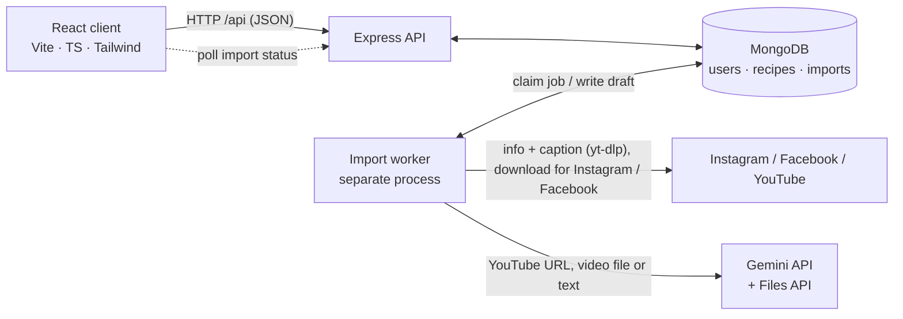
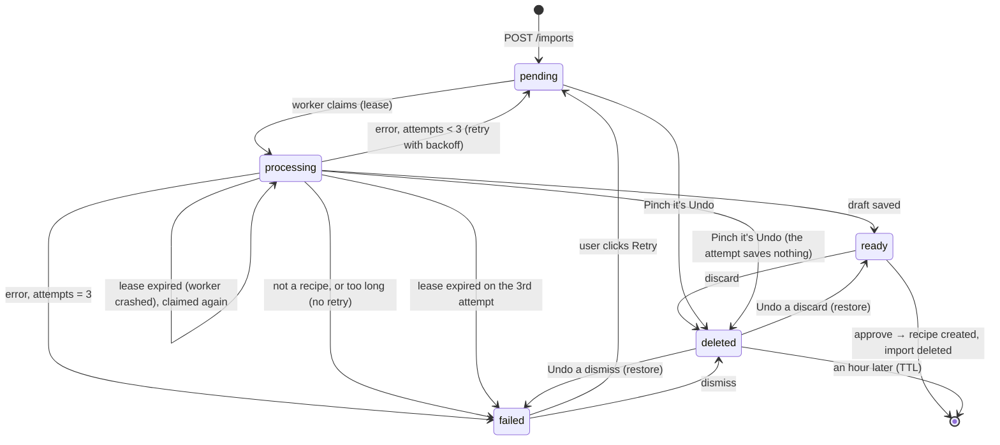

# Pinch — system design

> **Pinch** — pinch a recipe from a reel, cook it later.
> A learning project: system design first, then code that is simple enough to read line by line.

Status: **design agreed, 2026-10-29.** Changes to the design are made in this file.

---

## 1. Requirements

### Functional (v1)

1. **Import from a link.** The user pastes a link to an Instagram, Facebook or YouTube reel or
   video. The system turns it into a structured recipe.
2. **Fallback input.** If a link can't be read, the user can paste the caption text or upload
   screenshots instead.
3. **Draft and review.** An import produces a **draft**. Nothing is saved as a recipe until the
   user reviews, edits and approves it.
4. **Import status.** The user sees each import's progress (`waiting → fetching → analyzing →
   ready to review`) or a readable failure with **Retry**.
5. **Categorize.** The AI tags each recipe by cuisine, meal, diet, flavor and best fit.
6. **Nutrition.** An estimate per serving (calories, protein, carbs, fat), marked as an estimate.
7. **Manage.** Create a recipe by hand, edit it, delete it.
8. **Find.** Free-text search plus tag filters, newest first.
9. **Ownership.** Every recipe belongs to one user and only that user sees it.
10. **Cook mode.** A recipe opens for cooking: one step at a time in large type, with the
    screen kept on (docs/ux/plan.md U2).
11. **English and Hebrew** (M10, §16). The user picks the language in the avatar's menu; it is
    saved on the account and follows them to other devices. Hebrew turns the whole interface
    right to left; a recipe, and anything else the user wrote, keeps its own direction.

### Placeholders (UI only, no backend in v1)

- **Share** — a button that says "coming soon".
- **Comments** — a section that says "coming soon". (When built: its own collection, never an
  array inside the recipe, because it grows without limit.)

### Later

Share, comments, a WhatsApp bot or PWA share target, nutrition from a real database, semantic
search. (Accounts are M9: §8.3, D29.) ("recipes like this one").

### Out of scope

Meal planning, shopping lists, scaling servings, Instagram/Facebook **stories** from a link
(they expire after 24h and are usually private; the screenshot fallback covers them).

### Non-functional

| Concern | Target |
|---|---|
| Scale | ~100 users × ~100 recipes (a POC) |
| Responsive | Phone first; works on tablet and desktop |
| Look and feel | Clean and friendly; it should feel finished |
| CRUD latency | < 300 ms |
| Import time | Typically < 60 s, always **asynchronous**: the UI never waits on it |
| Video length | ≤ 5 minutes (checked before downloading when the platform reports it; otherwise right after, see §4.1) |
| Reliability | A crash never loses an import or creates a duplicate recipe |
| Media | **Never stored**, beyond an import's own: a video lives for one attempt, uploaded screenshots until the draft is made (§6). Only text, plus a tiny thumbnail (§5) |
| Cost | Imports per user per day are capped (default 20); online for about $5–9 a month plus Gemini (§15.7) |
| Languages | English and Hebrew (right to left), with no flash of the wrong language or direction; English looks exactly as before (M10, §16) |
| Online | At the user's own domain over HTTPS, deployed by every merge to `master` (M11, §15) |
| Code | Simple and consistent above all — every line should be easy to read |

## 2. Back-of-envelope numbers

- Recipe text ≈ 5 KB, thumbnail ≈ 30 KB → **≈ 35 KB per recipe**.
- 10,000 recipes ≈ **350 MB**: tiny for MongoDB, so one database server is plenty.
- Videos never reach our database. The largest object we hold is a temp video file for about a minute.
- Gemini calls take seconds and cost money. That is why imports are asynchronous and capped.

## 3. High-level design



Three processes, one codebase:

| Process | Job |
|---|---|
| **client** | The React app. Talks only to the API. |
| **API** | Express. Validates input, reads and writes Mongo, creates import jobs. Never calls Gemini or downloads anything, so it always answers fast. |
| **worker** | A loop that claims import jobs from Mongo, does the slow work and writes the result back. Started with its own command; can crash or be restarted without touching the API. |

Mongo is the only shared state. There is no Redis, no queue service and no object storage.

Online (M11), the API and the worker are two process groups of one image on Fly.io, the API
also serves the client's build, and Mongo is Atlas: §15.

## 4. The import pipeline

### 4.1 Flow

1. The client sends `POST /api/imports` with `{ type: "link", url }` or `{ type: "text", text }`.
   The API validates it, finds a link's platform (`instagram | facebook | youtube`), checks the
   daily cap, creates an import with
   `status: "pending"` and answers **202** with the import.
2. The worker **claims** the job, then:
   - **Every link** → read the post's info with `yt-dlp`: its length, checked against the
     limit, and its **caption**, which often holds the full recipe with quantities (D15).
   - **YouTube** → no download: send the URL to Gemini directly (Gemini can watch public
     YouTube videos).
   - **Instagram / Facebook** → one `yt-dlp` call reads the info and downloads to a temp
     folder (100 MB at most, when the platform says the size); upload to the **Gemini Files
     API**. Instagram doesn't report a length, so for it the length is checked after the
     download with `ffprobe` (the spike found reels of 3–11 MB); a long Facebook video is
     downloaded before it's turned down. A post with no video (a photo post) is read from its
     caption alone.
   - **Text / screenshots** (fallback) → send them to Gemini as they are: no `yt-dlp`, no
     video. Pasted text is the post's text, so it's fenced as data like a caption (§9).
3. Gemini gets the video and the caption together and returns JSON that matches our recipe
   schema (structured output), with the fields it was unsure of marked (§6, §9). The worker
   **validates it with Zod**, makes the thumbnail (§5), saves `draft` on the import, sets
   `status: "ready"`.
4. **Cleanup in `finally`**: delete the temp file and the Gemini file. Media lives for about a minute.
5. The client polls `GET /api/imports` (all of them in one request) every 2 s while any is
   pending or processing, then stops; a ready one is opened for review.
6. The user edits and approves → `POST /api/imports/:id/approve` → a recipe is created (with
   the draft's nutrition estimate, which the form doesn't edit) and the import is deleted (§4.4).

### 4.2 States



"Deleted" isn't a status: it's `deletedAt` set on the import, whatever its status, which restore
unsets (D27). Every read leaves deleted imports out, the claim never takes one, and the worker's
writes skip one, so an import deleted while it's processing never turns ready.

`step` (`fetching | analyzing`) is shown inside `processing` for progress. The extractor sets
it as each part starts (a link is fetched, then analyzed; a text is only analyzed), only while
the attempt still holds the job, as every worker write. A claim starts it empty, and every end
of an attempt clears it.

### 4.3 Worker mechanics (the queue lessons)

- **Atomic claim.** One `findOneAndUpdate` both finds and takes a job, so two workers can never
  take the same one:
  ```js
  findOneAndUpdate(
    { $or: [
        { status: "pending", nextAttemptAt: { $lte: now } },
        { status: "processing", leaseUntil: { $lt: now } },   // a crashed worker's job
    ] },
    { $set: { status: "processing", leaseUntil: now + 3min }, $inc: { attempts: 1 },
      $unset: { step: "" } },                                   // a crashed attempt's step
    { sort: { createdAt: 1 } },
  )
  ```
- **Lease.** If the worker dies mid-job, `leaseUntil` passes and the job is claimed again (the
  same idea as an SQS visibility timeout).
- **Deadline.** A whole attempt must finish inside its lease, or a second worker would claim a
  job that is still running. So each attempt has a deadline under the lease (about 150 s),
  and every external call in it (`yt-dlp`, upload, Gemini) has a timeout inside that. In the
  spike one Gemini call hung for 27 minutes. A timeout is a failed attempt and retries as usual.
- **Retries with backoff.** A failed attempt goes back to `pending` with `nextAttemptAt` = now +
  10 s, then 60 s. After 3 attempts → `failed` with a readable `error`. A failure no retry can
  fix (not a recipe, a video over 5 minutes) fails the import at once, with its own message
  and `noRetry: true` (D23): the list offers only Dismiss, and the API refuses its retry. A
  job whose worker died on its third attempt is failed when it's claimed again, not run a
  fourth time.
- **Back-pressure.** At most **2 jobs at a time** per worker, to stay within Gemini rate limits.
- **Idle polling.** With nothing to do, the worker checks again after 1 s.
- **Errors don't stop it.** A database error (Mongo restarting) is logged, and the loop tries
  again after 1 s, rather than end the worker: in development nothing would start it again. A
  job it held is claimed again when its lease runs out.
- **Stalled.** An import still unclaimed 5 minutes after it was due (`nextAttemptAt`, or a
  held one's `leaseUntil`) means no worker is running: the API marks it `stalled`, and the
  client says so and offers Dismiss instead of "working on it" forever. Not exact: with more
  than about four links queued ahead (two at a time, up to 150 s each), a waiting one shows as
  stalled though the workers are busy. Fine for one user; a worker heartbeat would be exact.
- **Expiry.** Every import has `expiresAt` = 7 days; a **TTL index** makes Mongo delete abandoned
  imports by itself.
- **Deleted while it runs** (D27). DELETE only sets `deletedAt`. The claim asks for jobs without
  it, and every write of an attempt (step, picture, draft, failure, retry) matches the job only
  while it's still `processing`, at this attempt's count, and not deleted. Each check-and-write
  is one document's `updateOne`, atomic without a transaction (D9): a delete lands wholly before
  a write (which then updates nothing) or after it (a ready, deleted import: never shown, and
  gone with the TTL). So Pinch it's Undo, at any moment, means the draft never shows.

### 4.4 Approve is idempotent

Approve does two writes: create the recipe, delete the import. A crash between them must not
create a duplicate recipe when the user clicks again.

- The recipe stores `sourceImportId` under a **unique, sparse index**.
- Approve: insert the recipe; on duplicate-key error (`11000`) treat it as "already done"; then
  delete the import. The recipe's `source` is the import's link and platform.
- Repeating approve always ends with exactly one recipe and no import. No transaction and no
  replica set needed. (Chosen over a transaction: §8, decision D9.)

### 4.5 Link extraction risks

| Source | How | Risk |
|---|---|---|
| YouTube | Gemini reads the URL; `yt-dlp` reads the length and caption | Low; public videos only |
| Instagram reel/post | `yt-dlp` download | Medium: breaks when Instagram changes; public posts needed no cookies in the spike; a grey area under Instagram's terms — acceptable for a personal POC, not for a product |
| Facebook reel | `yt-dlp` download | Same as Instagram |
| Stories | Not supported from a link | Use the screenshot fallback |

**The spike (M0)** measured this before building anything else: 12 real links (6 YouTube, 3
Instagram, 3 Facebook). `yt-dlp` read all of them without cookies; Gemini turned 10 into
recipes, correctly rejected one promo, and one call hung. Results and findings are in
`docs/spike-results.md`.

### 4.6 A link pinched before (D28; L1 and L2 built in M9)

Every link import carries `linkKey`, the post it points to: `instagram:C9x…`, `youtube:abc`,
`facebook:123…` (`shared/src/linkKey.ts`: Instagram's `/reel/`, `/reels/`, `/p/` and `/tv/`,
also under the author's name (`/chef/reel/…`); YouTube's `shorts/`, `watch?v=`, `youtu.be/`,
`embed/` and `live/`; Facebook's `/reel/`, `watch?v=`, `video.php?v=` and `/<page>/videos/`). A
link with no id we know (`fb.watch/…`, Facebook's `share/r/…` and `story.php?story_fbid=…`) keys
as `url:` plus its host (lower case, without `www.` or `m.`), its path and its query, without the
hash and the share and tracking parameters (`utm_*`, `igsh`, `si`, `fbclid`, `mibextid`,
`feature`, `ref`…), the rest sorted: the query may name the post, and merging two posts would
stop the user pinching the second, while splitting one only costs a Gemini call. Approve copies
it to the recipe's `source.linkKey`. The key is stored, never sent: the client has no use for it.
(It's read with a pattern, not `URL`: `shared/` is plain ES.)

1. **This user has it (L1).** `POST /api/imports` looks first: a recipe of theirs with that key
   (not deleted), or an import of theirs with it that is pending, processing or ready, answers
   **409** `{ error: { code: "link_pinched_before", message }, existing }`
   (`DuplicateLinkSchema`): `existing` is `{ kind: "recipe", id, title }` or `{ kind: "import",
   id, status, title?, lookAt? }`, a ready draft's title and its count of things to look at. It's
   answered before the daily cap is counted, so nothing is queued or counted. The client shows it
   as a toast, not an error: "Already in My recipes · Shakshuka" (View), "Already pinching it" ("It's in your queue"),
   "Shakshuka is ready to review" (Review). A deleted recipe and a failed import don't count:
   pinching again is asking for it again, so the new import deletes (D27) the failed ones of that
   link, whose Retry would make a second recipe. Two tabs pasting the same link at the same
   instant can still make two imports (a partial index can't say "only the active ones"): rare,
   and harmless. `npm run db:backfill-link-keys` gives the key to the links and recipes saved
   before L1.
2. **Anyone has it (L2).** The shared `links` collection keeps the model's answer for each post:
   one document per `{ key, version }`, with no owner. After the worker claims a link import it
   looks there: on a hit it checks the draft with `RecipeDraftSchema` (one that no longer reads
   is a miss), copies it and the pictures into the import with the same fenced write as any
   attempt (§4.3) and makes it ready: no `yt-dlp`, no Gemini, and the user reviews it as any
   draft. On a miss it runs as now and, when the answer is a recipe, upserts it
   into `links` (a fresher answer replaces an older one, whole), once it has reached the import:
   an answer for a job deleted meanwhile isn't kept. A job with no `linkKey` (from before L1)
   isn't looked up. `links` is a cache, not a queue: nothing claims, leases or retries it, and the
   queue stays `imports`. The worker logs `cache hit` with the key, never the user.

- **The version** is a short hash of the model, the prompt and the response schema
  (`EXTRACTION_VERSION`: the first 12 hex characters of SHA-256 over the three, in
  `geminiExtract.ts`), so a change to any of them stops old answers matching, with no bump to
  forget. The fake extractor's is `fake-1`, so its answers never mix with Gemini's. The API and
  the worker both read it from `EXTRACTION[EXTRACTOR]` (`server/src/extraction.ts`): each reads
  `EXTRACTOR` from the same `.env`.
- **Only recipes are kept:** a failure, "not a recipe" and "too long" never are. Text and
  screenshot imports are never looked up or kept: they're one user's own.
- **Copies, not references:** a user's import and recipe get their own copy, so editing,
  tagging or deleting theirs never touches the shared answer or anyone else's.
- **Free:** a hit costs no Gemini call, so it doesn't count against the daily cap (D22) or the
  global one (D30). `POST /api/imports` does the same `{ key, version }` lookup to decide, after
  L1's 409 and before either cap is counted; if the answer arrives between the two, the import is
  at worst one free Gemini call. Free hits are bounded only by the API's request rate. Retry is counted as before: a failed link is rare, and its
  retry is one route more to change for little.
- **Private posts never reach it:** the worker fetches without logging in, so only public posts
  are ever read.
- **A wrong answer** is served to everyone until the prompt or the model changes; for now
  `npm run links:forget <url>` removes one (L2). Already-ready drafts don't seed the cache: it
  fills from new imports.

## 5. Thumbnails

Media is thrown away, but a good-looking list needs images, so each recipe keeps **one tiny
thumbnail** inside its document: WebP inside 400 × 500 (its own shape kept), 20–40 KB, made
with `sharp`, with its width and height so the page keeps its place before it loads, and
beside it (`small`) the queue's tile: 160 × 200 cropped to it (the 64 × 80 tile at 2.5× DPR),
a few KB, made at the same time, so the queue's pictures don't compete with the entry JS
(docs/metrics/m08.md; My recipes' cards and a recipe's page are bigger and keep the picture). The
worker saves it on the import as soon as it has it (as the step), reading at most 5 MB, from
https, with no redirect; approve copies it to the recipe, and editing keeps it (D20). Making it
never fails an import: no picture, no thumbnail.

| Source | Thumbnail from |
|---|---|
| Instagram / Facebook / YouTube | The post's own picture (`yt-dlp`'s `thumbnail`: the reel's cover, YouTube's image), fetched at once (the platforms' links expire) and resized. Chosen over a frame cut with `ffmpeg`: the cover is the picture the author chose, and one path serves all three |
| Screenshots | The first screenshot, resized |
| Text / manual | None → the recipe's emoji on a soft tile (D25) |

Served by `GET /api/recipes/:id/thumbnail` (a draft's by `GET /api/imports/:id/thumbnail`) with
long cache headers; `?size=small` sends the tile, or the picture when it was made before tiles
(no migration: the browser shrinks it, as before). Every query that answers recipes or imports
leaves both images out, so list responses stay small.

## 6. Data model (MongoDB)

```ts
User {                             // M9 (§8.3, D29)
  _id, email,                      // lowercase, unique
  name, createdAt,
  passwordHash?,                   // argon2id; none for an account made with Google
  googleId?,                       // Google's "sub"; set by a Google sign-in
  language?: "en" | "he"           // M10: the interface's language (§16, D40); none reads as "en"
}

Session {                          // M9: a signed-in browser (§8.3)
  _id, userId,
  tokenHash,                       // SHA-256 of the cookie's token; the token itself is never stored
  createdAt, expiresAt             // TTL
}

PasswordReset {                    // M11: a link to set a new password (§8.3, D33)
  _id,                             // the user's id: one live link per account
  tokenHash,                       // SHA-256 of the emailed token, as a session's
  createdAt, expiresAt             // TTL: an hour later
}

LoginAttempt {                     // M9: the login rate limit (§8.3)
  _id: "email a@b.com 2026-11-11T10:05",   // what is counted ("ip …" or "email …") and its minute
  tries, expiresAt                 // TTL: two minutes later
}

Link {                             // L2: the model's answer for a public post, shared (§4.6, D28)
  _id, key, version,               // unique together: "instagram:C9x…", EXTRACTION_VERSION
  platform,                        // not the link: its tracking parameters can name who shared it
  draft: RecipeDraft,
  thumbnail?: { webp: Binary, small?: Binary, width, height },
  model, extractedAt
}

Recipe {
  _id, ownerId, title, description?,
  ingredients: [{ name, quantity?, unit?, note? }],   // quantity is text: "1/2", "a pinch"
  steps: [string],
  tags: [string],                  // "cuisine:italian", "flavor:spicy" — see §7
  servings?, prepMinutes?, cookMinutes?,
  nutritionPerServing?: { calories, proteinG, carbsG, fatG },   // always Gemini's estimate (D14)
  emoji?: "🍲",                    // its face without a picture (D25): the model's, or its title's
  thumbnail?: { webp: Binary, small?: Binary, width, height },   // the images left out of every query that answers
  source: { type: "instagram" | "facebook" | "youtube" | "text" | "image" | "manual", url?, linkKey? },   // linkKey: L1 (§4.6)
  sourceImportId?,                 // unique + sparse (§4.4)
  createdAt, updatedAt,
  deletedAt?                       // set by DELETE, unset by restore; TTL an hour later (D27)
}

Import {
  _id, ownerId,
  status: "pending" | "processing" | "ready" | "failed",
  step?: "fetching" | "analyzing",
  input: { type: "link" | "text" | "images", url?, platform?, text?, count?, images? },
  linkKey?,                        // a link's post (§4.6, L1)
  attempts, nextAttemptAt, leaseUntil?, error?, noRetry?,
  draft?: RecipeDraft, thumbnail?: { webp: Binary, small?: Binary, width, height },   // named as on a recipe
  createdAt, updatedAt, expiresAt,  // TTL
  deletedAt?                       // as a recipe's (D27)
}

RecipeDraft = RecipeInput + {
  nutritionPerServing?,
  emoji?,                          // one food emoji for the dish (§9, D25)
  uncertain?: [{ path, reason }]   // "things to look at": up to 10 (§9); for the review only
}

Usage {                            // the daily cap (D22), and the global one (D30, M9)
  ownerId, day: "2026-11-07",      // the UTC day; ownerId "all" for the global count
  imports,                         // links pasted + Retry clicks that day
  expiresAt                        // TTL: two days later
}
```

A draft's `uncertain` marks the fields the model was unsure of, or couldn't find, with a short
reason: `{ path: "ingredients.3.quantity", reason: "the video says a can" }`. A path names a
field as the API's errors do (§8.1): `title`, `servings`, `prepMinutes`, `cookMinutes`,
`steps.N`, or `ingredients.N.quantity` / `.unit` / `.name`. They're a hint, so they never fail
a draft: a reason is cut to 200 characters; a list that isn't one (null, a mark with no path or
reason) is dropped whole; a mark that names no field of the draft (malformed, or past the last
step), has an empty reason or repeats a field is dropped; the first 10 are kept. The draft's
schema checks them when the worker saves the draft and again whenever the API reads it. A saved recipe doesn't keep them: approve takes the form's
recipe (§8), which has no marks.

A recipe's `emoji` is its face when it has no picture (D25): one emoji, which the model picks for
the draft and approve copies, as the nutrition; a recipe written by hand gets the one its title
names, from a short list of dishes in English and Hebrew (`server/src/titleEmoji.ts`: "soup" 🍲,
"סלט" 🥗; the first match in the list wins), or none. Like the marks it is a hint, so it never
fails a draft: the check keeps exactly one pictographic grapheme (an emoji, a ZWJ sequence or one
with a skin tone, at most 16 code units) and drops anything else, flags and keycaps included,
whenever the schema reads it; a browser without `Intl.Segmenter` drops them all. The user doesn't
write it, and editing keeps it (D20); a recipe with none (saved before it, or a title the list
doesn't know) shows a cooking pot, with Pinch's sparkles beside it when it came from a video (§14).

Uploaded screenshots for the fallback (up to 4 PNG, JPEG or WebP files, each made a JPEG at
most 1600 px on a side by the API: typically 200–400 KB, under 2 MB at worst) are held on the import (`input.images`) only until the draft is made:
a failed attempt keeps them for the next try; the import's TTL deletes them in any case.
Every query that answers imports leaves them out.

### Indexes

| Collection | Index | Serves |
|---|---|---|
| recipes | `{ ownerId: 1, tags: 1, createdAt: -1, _id: -1 }` | My recipes, filtered by tags, newest first |
| recipes | `{ ownerId: 1, createdAt: -1, _id: -1 }` | My recipes, no filter, cursor pagination |
| recipes | `{ ownerId: 1, title: 1, _id: 1 }`, collation `en`, strength 2 | My recipes A–Z, whatever the case |
| recipes | `{ ownerId: 1, title: "text", "ingredients.name": "text" }` | Text search inside my recipes |
| recipes | `{ sourceImportId: 1 }` unique, sparse | Idempotent approve |
| recipes, imports | `{ deletedAt: 1 }` TTL (`expireAfterSeconds: 3600`), partial: only documents that have it | A deleted one goes for good an hour later (D27); no read can use it, so it never competes with the others |
| imports | `{ status: 1, nextAttemptAt: 1 }` | The worker's claim query |
| imports | `{ ownerId: 1, createdAt: -1, _id: -1 }` | "My imports" list in the UI |
| imports | `{ expiresAt: 1 }` TTL (`expireAfterSeconds: 0`) | Automatic cleanup |
| usage | `{ ownerId: 1, day: 1 }` unique | Today's count (the daily cap) |
| usage | `{ expiresAt: 1 }` TTL | Old days go |
| recipes | `{ ownerId: 1, "source.linkKey": 1 }`, partial: only those that have it | "Already in My recipes" (L1) |
| imports | `{ ownerId: 1, linkKey: 1 }`, partial: only those that have it | "Already pinching it" (L1) |
| links | `{ key: 1, version: 1 }` unique | The worker's lookup and upsert (L2) |
| users | `{ email: 1 }` unique; `{ googleId: 1 }` unique, sparse | Sign-in (M9) |
| sessions | `{ tokenHash: 1 }` unique; `{ expiresAt: 1 }` TTL | Every request's user; old sessions go (M9) |
| loginAttempts | `{ expiresAt: 1 }` TTL (found by `_id`, so no other index) | Old minutes' counts go (M9) |
| passwordResets | `{ tokenHash: 1 }` unique; `{ expiresAt: 1 }` TTL (replaced by `_id`) | A reset link's lookup; old links go (M11) |

Every index is checked with `.explain("executionStats")`: expect `IXSCAN`, and
`totalDocsExamined` close to `nReturned` (a search fetches each match twice, by the text match
and the not-deleted check, D27: still only the matches).

**Sample data:** `npm run db:seed <email>` adds ten sample recipes for that account (sign up
first, §8.3), so the list, search and filters have something to find; each e2e file's user gets
the same ten through the API (`e2e/fixtures.ts`). Each sample has a fixed id and is written only
when it's missing: running it again leaves an edited sample as it is, and puts back one that was
deleted. The fixed ids make them one account's per database: seeding a second fails.

## 7. Find

**Tags are one flat array of `facet:value` strings.** MongoDB can't put two array fields in one
compound index ("parallel arrays"), so separate `cuisine[]` and `flavor[]` arrays could not be
indexed together. One array can.

Facets and their allowed values (fixed lists, so filters stay clean; the AI must pick from them):

| Facet | Values (first draft) |
|---|---|
| `cuisine` | italian, asian, middle-eastern, mexican, american, french, indian, mediterranean, other |
| `meal` | breakfast, lunch, dinner, snack, dessert, drink |
| `diet` | vegetarian, vegan, gluten-free, dairy-free, kosher-dairy, kosher-meat, parve |
| `flavor` | sweet, savory, spicy, sour, smoky, fresh |
| `fit` | quick, weeknight, meal-prep, party, kids, healthy, comfort |

Queries:

- **Filters only:** `{ ownerId, tags: { $all: [...] } }`, sorted by `createdAt: -1`, **cursor
  pagination** on `(createdAt, _id)`: the next page asks for items older than the last one seen.
  (`skip` reads and throws away every skipped document, so it gets slower page by page.)
- **The cursor** is the last recipe's `(createdAt, _id)`; the next page is
  `{ $or: [{ createdAt < c }, { createdAt = c, _id < id }] }` plus a plain `createdAt ≤ c`.
  Without that range, Mongo's chosen plan scanned the index from the newest recipe and dropped
  the pages before (`explain`: 101 documents read for a page of 51). A page asks for 51 and
  answers 50, so `nextCursor` is null on the last page instead of pointing at an empty one.
- **Tags:** the index holds one entry per tag of a recipe (multikey), so with two tags the scan
  reads the recipes with the **first** tag of `$all` and checks the other on each; Mongo doesn't
  pick the rarer one. With every recipe a dinner and half Italian, `cuisine:italian,meal:dinner`
  reads 51 documents for a page of 51 (`explain`, in a test), `meal:dinner,cuisine:italian`
  reads 101. Either is fast at this scale, and never more than my recipes with that one tag; if
  it matters later, the route can put the narrower facet first.
- **Sort, Time and Source** (M8 F1): `sort` is `newest`, `quickest` or `az`; left out, newest
  first, or with a search, the best match first. Each order sorts by one value, then `_id` the
  same way, and the cursor is the order, that value and the `_id` (`newest:<ms>_<id>`,
  `quickest:<minutes>_<id>`, `az:<title>_<id>`), so a cursor sent with another order is a 400. A–Z ignores case (a collation, `en` strength
  2, and an index with the same one). A recipe's time is prep and cook together, or the one it
  has; one with neither counts as longer than any (Quickest puts it last, a time filter leaves it
  out). No recipe stores that sum, so `time=15|30|60` is an `$expr` and Quickest an `$addFields`
  before the sort: both read every one of my recipes the other filters leave, rather than an
  index (one household's library: hundreds, at most a few thousand). `source=instagram,manual`
  is any of the sources (`manual` is "Written by me"; pasted text and screenshots have no
  filter). The query is one aggregation, so every filter and order goes together.
- **Text search:** `{ ownerId, $text: { $search: q } }` plus the same filters; its 50 best
  matches by text score (`_id` breaks ties), best first, or in the order asked when `sort` is set. At POC scale
  that is enough; no deep pagination for search. A recipe matches if any word of `q` is in its
  title or an ingredient's name. The text index
  stems English ("eggs" finds "egg"); Mongo has no Hebrew stemmer, so Hebrew matches whole
  words only ("חריף" doesn't find "חריפה"). Quotes ask for a phrase and a leading "-" leaves a
  word out (Mongo's `$search` syntax); a search of only stop words ("the") finds nothing.
  Smarter search is semantic search, later (§1).

## 8. API

All under `/api` (the health routes too, so the Vite proxy covers everything), JSON, errors as
`{ error: { code, message } }` (plus `fields` for invalid input, §8.1). `ownerId` always comes from
the request's user (§8.3), never from the body or the URL.

```
GET    /api/health                     the process is up
GET    /api/ready                      the database is reachable

GET    /api/recipes?q=…&tags=cuisine:italian,flavor:spicy&source=instagram,manual&time=30&sort=quickest&cursor=…   → { items, nextCursor } (no sort: newest first, or with q the best match first)
GET    /api/recipes/count              → { count }: the user's recipes, for the My recipes tab (a count needs no page)
POST   /api/recipes                    create by hand (its emoji from its title, §6)
GET    /api/recipes/:id
PUT    /api/recipes/:id                replace what the user can edit (the form sends it all)
DELETE /api/recipes/:id                kept an hour, to undo (D27) → 204
POST   /api/recipes/:id/restore        Undo of a delete → 200 recipe (404 once it's gone for good)
GET    /api/recipes/:id/thumbnail      image/webp (?size=small: the 160 × 200 tile, §5)

POST   /api/imports                    { type: "link", url } | { type: "text", text }  → 202 import (429 `daily_limit` past the user's daily cap, `global_limit` past everyone's, D30; 409 { existing } when this user has the link, L1)
POST   /api/imports/screenshots        a form: up to 4 images (10 MB each) as "images"  → 202 import { type: "images", count }
GET    /api/imports                    my imports that are not done yet (a ready one's draft with its marks: the queue counts them)
GET    /api/imports/:id                status, step, error, draft (with its uncertain marks, §6)
GET    /api/imports/:id/thumbnail      image/webp: the draft's picture (?size=small: the queue's tile, §5)
POST   /api/imports/:id/approve        the edited draft, as POST /api/recipes; nutritionPerServing, the emoji and the thumbnail from the stored import (D20), the marks dropped → 201 recipe (409 if not ready)
POST   /api/imports/:id/retry          failed → pending, attempts, error and noRetry cleared → 202 (409 if not failed, or noRetry)
DELETE /api/imports/:id                discard / dismiss / Pinch it's Undo: kept an hour (D27) → 204
POST   /api/imports/:id/restore        Undo of a discard or a dismiss → 200 import, as it was

POST   /api/auth/signup                { email, password, name, language? } → 201 me, signed in (M9; language: the page's, M10; 409 when the email has an account; 429 past 10 a minute per IP)
POST   /api/auth/login                 { email, password } → 200 me (401 the same for either wrong; 429 past the rate limit)
POST   /api/auth/logout                → 204 (with Content-Type: application/json, else 415)
GET    /api/auth/me                    → 200 { id, email, name, language } (null signed out, §8.3; language: M10)
PATCH  /api/auth/me                    { language: "en" | "he" } → 200 me, and the pinch_lang cookie (M10, §16; JSON only, 401 signed out, 400 any other field or value)
GET    /api/auth/providers             → 200 { google: boolean } (Google is on only with its settings)
GET    /api/auth/google?next=…&lang=…  → 302 to Google (404 without Google's settings; counted as a login per IP; lang: the page's, for a new account, M10)
GET    /api/auth/google/callback       → signed in, 302 to next; a failure → 302 /login?error=google&reason=… (counted per IP too)
POST   /api/auth/forgot                { email } → 202, the same whether or not it has an account; emails a reset link if it has (M11; 429 past the rate limit)
POST   /api/auth/reset                 { token, password } → 200 me, signed in, every other session ended (400 `reset_expired` for a used or expired link; 429 past 10 a minute per IP)
```

One set of **Zod schemas** defines the Gemini output, the API input and the TypeScript types,
so they can't drift apart.

### 8.1 Validation

Every request body and query string is parsed with Zod before it reaches the handler. Invalid
input → 400 `invalid_input` with `fields`: each failed field by its path and a message the form
can show, e.g. `{ "title": "Give the recipe a title.", "ingredients.0.name": "Name the
ingredient." }`. A missing body, or one that isn't JSON → 400 `bad_request`; too large → 413
`too_large`.

The form checks with the same schema before it sends (shared `fieldErrors` builds `fields` on
both sides), so the user sees the API's messages without a round trip; the API's 400 is still
shown the same way, under the field it names.

### 8.2 Errors

Handlers throw; one Express error middleware turns errors into the JSON shape above and logs
them. No try/catch in each route.

### 8.3 Accounts (M9, D29)

Until M9 a small middleware set `req.userId` from config `DEV_USER_ID`. Every query already
filtered by `ownerId: req.userId`, so M9 changed **only that middleware**: `requireUser`
(`server/src/requireUser.ts`), in front of `/api/recipes` and `/api/imports`, reads the session
(`currentSession`: one lookup by the token's hash, not the account) and sets `req.userId`; a
request without a live session gets 401 `signed_out`. The health routes and `/api/auth/*` stay
open; `GET /api/auth/me` answers 200 with the user, or with `null` when nobody is signed in:
signed out is a state every signed-out page asks about first, not an error (a 401 is logged in
the browser's console). Another user's recipe or import is a 404, as before. The worker is unchanged: it reads
`ownerId` from each job.

- **Sign-up is open:** email and password, or Google. Each account has the daily cap of 20
  (D22); a global daily cap on Gemini calls (D30) bounds what many accounts can spend.
- **Passwords:** argon2id (`@node-rs/argon2`, its default parameters: prebuilt, no compiler);
  emails stored lowercase; at least 8 characters (and at most 200), no other rules. A second
  sign-up with an email answers 409. Sign-ups are limited to 10 a minute per IP, counted before
  the hash: each hash takes 19 MiB, so a burst could exhaust the server's memory.
- **Sessions:** a random 32-byte token (base64url) in a `pinch_session` cookie,
  `HttpOnly; SameSite=Lax; Path=/`, 30 days' `Max-Age`, and `Secure` in production
  (`NODE_ENV`); development and tests run on `http://localhost`, so the API turns it off there,
  while `createApp` defaults to Secure, so a caller who forgets gets the safe one; the database keeps only its
  SHA-256 hash in `sessions`, with `expiresAt` 30 days out and a TTL index. A session past its
  `expiresAt` counts as none before the TTL deletes it. Beside it, a **hint cookie**,
  `pinch_signed_in=1` (`SameSite=Lax; Path=/`, the same `Max-Age` and `Secure`, but not
  `HttpOnly`): set with every session (and by `me` for a session that lacks it), cleared by logout, and cleared by any answer to a request
  without a live session (`requireUser`'s 401, `me`'s `null`). `index.html` reads it in a tiny
  inline script and preloads `/api/imports` only when it's there, and `main.tsx` waits for the
  queue before rendering `/` only then, so a signed-out page asks for nothing that would answer
  401. It's only a hint: it holds nothing secret, and the API decides
  from the session alone; a wrong hint costs at most one unused preload, or the queue asked a
  moment later. Online, the page's Content-Security-Policy allows this script by its hash, which
  the API computes from the file it serves (§15.4). A new session on every sign-in, which
  ends the browser's previous one if it sent its cookie; logout deletes it and clears the cookie. `currentUser` (`server/src/session.ts`) reads the cookie
  with a few lines, not a package.
- **The language cookie (M10, §16.2):** `pinch_lang=en|he`, as the hint is (`SameSite=Lax;
  Path=/`, `Secure` in production, not `HttpOnly`, nothing secret), but a year's `Max-Age` and
  **kept by logout**: the device stays in the last language, so Log in shows in it. The API
  sets it from the account with every sign-in, every `PATCH /api/auth/me`, and every `me` with a
  user whose request's cookie doesn't already say the account's language (as the hint, set only
  when missing); signed out, the page's switch sets it (`document.cookie`). The same inline
  script reads it and sets `<html lang dir>` before the first paint. The account decides once
  someone is signed in; the cookie only says it early.
- **Login:** the same 401 for a wrong email or a wrong password; an unknown email is still
  checked against a fixed hash, so the time doesn't tell which emails have accounts. A rate
  limit counted in Mongo (`loginAttempts`): 5 tries a minute per email and 20 per IP (a
  household shares one), each an atomic `$inc` on a document per key and minute, a fixed
  window, by a clock the app is given (tests pin it); past either, 429. Accepted for the POC:
  anyone can lock an email out for a minute at a time by failing 5 logins with it. The IP is
  Express's `req.ip`: `TRUST_PROXY` (config) is how many proxies stand in front of the API,
  default 0 (the connection's address; in development that's Vite's proxy, so everyone shares
  one); behind a real proxy it's set to that count, never `true`, which would let anyone pick
  their IP from `X-Forwarded-For`. An IPv6 address is counted whole, not by its /64, so someone
  with a /64 to rotate through gets many IPs' tries: the per-email limit still holds.
- **Google:** the OpenID Connect code flow with `state`, a `nonce` and PKCE (S256), written by
  hand in `server/src/google.ts` and `routes/google.ts`: two plain requests and `jose`'s
  `jwtVerify`, which checks the ID token's signature against Google's published keys (fetched
  once and kept; RS256 only), its issuer, its audience (our client ID) and its expiry; `openid-client` would
  hide the steps a learner should see, for no fewer lines. `GET /api/auth/google?next=…` (counted
  with the logins per IP) makes the state, nonce and code verifier, keeps them with `next` (made
  safe as the client's `nextPage` does, `//` after its dots included) in a `pinch_google` cookie (base64url JSON, `HttpOnly;
  SameSite=Lax; Path=/api/auth/google`, 10 minutes' `Max-Age`, `Secure` as the session's) and
  sends the browser to Google with `scope=openid email profile` and the verifier's SHA-256. The
  cookie needs no signature: it never leaves the browser but to these routes, no script reads
  it, and changing it gains nothing, as Google's answer must match it; and no collection is
  needed. A sibling subdomain could set ("toss") it, which a signature would stop; accepted, as
  Pinch has one origin and no subdomains of its own. `/callback` clears it (one use), counts
  with the logins per IP (`too_many_tries`), then checks in order: the cookie is there
  (`expired`), the state matches (`state`), a code came (`denied`: a refused consent), the
  exchange with the verifier (10 s at most) and the ID token (`token`; the log keeps jose's
  error code and message, not the error, which carries the token's claims), the nonce (`nonce`), `email_verified`
  (`unverified`); each failure goes to `/login?error=google&reason=<that word>`, never Google's
  own words. Its query (the code and state) is left out of the request's log line. Then the
  account: the one with this `googleId` (Google's `sub`); else the one with the email
  (lowercase) and no `googleId`, linked by storing it, which also **drops its password and ends
  its sessions**: Google proved the email is theirs, the unverified password hasn't (someone
  could have signed up with it first and waited); else a new one with Google's name and no
  password. An email whose account has another `googleId` can't sign in this way
  (`linked_elsewhere`). A new session, then a 302 to `next`. The routes take
  Google as a dependency of `createApp` (`google`, built by `googleFromConfig`), so the tests
  pass a fake exchange and need no network; `jose`'s check has its own tests with a key of
  their own. Without `GOOGLE_CLIENT_ID` and `GOOGLE_CLIENT_SECRET` (in `.env`, set by the user)
  the routes are 404 and `GET /api/auth/providers` says `{ google: false }`. The redirect URI is
  `<PUBLIC_URL>/api/auth/google/callback`: `PUBLIC_URL` (config) is where the browser opens the
  app, by default Vite's `http://localhost:5173`, which proxies `/api`.

  **To turn on Google sign-in:**
  1. In Google Cloud Console, APIs & Services → Credentials, create an OAuth client ID of type
     **Web application** (the consent screen first, if asked: External, with your email as a
     test user).
  2. Add the authorised redirect URI `http://localhost:5173/api/auth/google/callback` (in
     production, `<PUBLIC_URL>/api/auth/google/callback`).
  3. Put its ID and secret in `.env` as `GOOGLE_CLIENT_ID` and `GOOGLE_CLIENT_SECRET`.
  4. Restart the API (`npm run dev:api`).
- **CSRF:** SameSite=Lax, one origin (Vite proxies `/api` in dev), JSON-only mutations. Logout
  has no body, so it checks for `Content-Type: application/json` itself (415 without it): a form
  on another site can't send that, so it can't sign the user out.
- **The client:** Log in and Sign up pages (lazy chunks), each with "Continue with Google" under
  its button once `providersQuery` says Google is on (it asks only there): an outline button with
  Google's "G", a plain link to `/api/auth/google?next=<the page's next>`, as the sign-in is page
  loads, not a fetch. A failed one comes back to `/login?error=google`, which says "Couldn't sign
  in with Google. Try again." right above it, under a quiet "or" that sets it apart from the
  form's own button.
  `GET /api/auth/me` is a query (`meQuery`, preloaded by `index.html` with the queue, so it adds no
  round trip), and `SessionGate`, a layout route around each group of routes (D21), shows nothing
  until it answers (or, when it can't be asked, "We couldn't reach Pinch" with Try again, in Log in's frame, its
  message the alert), then
  sends a signed-out visitor to `/login?next=<the page>` and a signed-in one from `/login` or
  `/signup` to `next`. `next` is read as the browser reads it (`new URL`) and must stay on the
  site's origin, with a path that doesn't start `//` once its dots are resolved (`/.//x` is
  another site to a browser), else `/`. **A change of user is a new page:** Log in and Sign up load `next` (and
  Log out `/login`) with `location.replace`, so the new document asks again for what `index.html`
  preloads, now with the new cookie, and keeps nothing of the last user's (cached queries, toasts,
  module state). A session that ends mid-visit (any 401 from the API outside `/api/auth/*`,
  noticed in one place, `lib/api.ts`) isn't a new page: the client clears the cache and the toasts
  itself, and the gate goes to `/login?next=…`, so Log in comes back where it was. Log out is in
  the avatar's menu, with the name and email; it lands on plain `/login`, without `next`: the
  user chose to leave, and the next person on the device shouldn't land on their page.
- **Password reset (M11, D33):** "Forgot password?" on Log in opens `/forgot`, which sends
  `POST /api/auth/forgot { email }`. It always answers **202** the same way, before anything is
  looked up or sent, so neither the answer nor its time tells who has an account. It's counted
  in `loginAttempts` as the logins are, whether or not the email has an account: 5 a minute per
  IP and 1 a minute per email (`forgot ip …`, `forgot email …`), 429 past either. Then, for an
  account with that email: a random 32-byte token (base64url), its SHA-256 kept in
  `passwordResets` under the user's id (one live link per account: asking again replaces it, so
  only the newest email works), `expiresAt` an hour out, with a TTL; and an email through Resend
  from `EMAIL_FROM` (`server/src/email.ts`: one `fetch` to Resend's API, no SDK, as `google.ts`;
  a dependency of `createApp`, so tests pass a fake that keeps what was sent). The link is
  `<PUBLIC_URL>/reset#<token>`: in the hash, so it never reaches a request log, ours included
  (the request line keeps the URL). "It works once, for an hour. If you didn't ask, ignore this
  email." The email is in the account's language (`language`, M10, §16.7): its subject and
  lines in English and Hebrew in `email.ts`, the Hebrew one `dir="rtl"`, the link `dir="ltr"`.
  A failed send is logged, without the token. With no `RESEND_API_KEY` nothing is sent;
  in development the link is logged instead, so the flow can be tried locally.
  `/reset` takes the token from the hash, asks for a new password (`new-password`, the sign-up
  rules) and sends `POST /api/auth/reset { token, password }`, counted per IP as sign-ups are
  (each hashes a password). The reset is found by the token's hash and deleted in one
  `findOneAndDelete` while `expiresAt` is ahead, so a link works once, even clicked twice at
  the same moment; none is 400 `reset_expired`: "This link has expired or was already used.",
  with a way to ask again. Then the password is hashed and set, **every session of the user
  ends**, and a new one starts: 200 me, and the page loads `/` (a change of user is a new page).
  An account made with Google (no password) may set one this way: the email proves the inbox
  is theirs, the proof Google's `email_verified` gives, so this isn't the unverified password
  that linking drops; the account then signs in either way. A reset also undoes the squatter
  M9 accepted: whoever signed up first with someone's email loses it to the inbox's owner, and
  their sessions end.
- **Email verification** at sign-up stays out: a password account's email is unproven until a
  reset proves it. What that costs is a squatted address, and a reset recovers it.
- **The dev user's data:** `npm run db:adopt-dev-data <email>`, run once after signing up,
  gives the dev user's (`DEV_USER_ID`, which only this script still reads) recipes, imports and
  usage to that account; a day both have a count adds them up. It fails if no account has the
  email, and a second run finds nothing left to move.
- **Tests:** a route test signs in as a user of its own (`createTestUser`,
  `server/src/testUser.ts`: an account and a session written to the database, and the cookie).
  Each e2e file signs up a user of its own through `POST /api/auth/signup` in its first test,
  adds the samples, and reuses the cookie in its other tests (`e2e/fixtures.ts`), so files
  running side by side never see each other's imports or toasts. The request goes to the
  preview's origin, which proxies `/api`, so the cookie is the client's. The e2e API trusts that
  one proxy (`TRUST_PROXY=1`) and each file signs up from an `X-Forwarded-For` of its own: there
  are more files than the 10 sign-ups a minute one IP gets.
- Out of M9: password reset (M11, above), email verification for password accounts (left
  out, above), other providers.

## 9. Gemini

- One function, `geminiExtract` (`server/src/worker/geminiExtract.ts`): an import's input → the
  model's JSON, which the worker checks with Zod. The worker doesn't know anything else about
  Gemini, so the model or provider can change in one place.
- The current Gemini Flash model (`gemini-3.5-flash`, checked in M5), with **structured
  output**: the response schema is generated from the Zod schema (`z.toJSONSchema`, input
  side), without `maxItems`, which Gemini refuses; Zod still checks those limits.
- The input is the video (or text / screenshots) **plus the post's caption** (D15). The caption
  is a stranger's text: it is sent as data to read, never as instructions, and the output is
  still bound by the schema, Zod and the user's review.
- The prompt asks for: title, ingredients with quantities and units, steps, servings, times, tags
  from the fixed lists only, and a nutrition estimate per serving. If the video isn't a recipe,
  the model says so and the import fails with "This doesn't look like a recipe".
- It also lists, in `uncertain`, up to 10 fields it was unsure of or couldn't find, each by
  its path with a short reason (§6): the user's "things to look at" when reviewing. The
  prompt names the paths it may use. A mark never fails an import: a reason is cut to 200
  characters, and a malformed list or a mark that names no field is dropped (§6).
- And one food emoji that fits the dish (`emoji`), the face of a recipe without a picture (D25).
  It is a plain string in the response schema; Zod keeps it only if it's one emoji (§6).
- The recipe is written **in the language of the post**; tags stay English codes (D16).
- Every call has a **timeout** (the client's: 120 s a request), and the attempt's deadline
  (§4.3) cuts the whole attempt. No retries of its own (the SDK only retries when asked), except
  an upload's chunks, which the SDK tries up to 3 times: the worker's retries are the others.
- The worker uses the fake extractor of M4 instead when `EXTRACTOR=fake`: e2e runs that way,
  so no test calls Gemini.
- A link's answer is kept in the shared `links` cache by `EXTRACTION_VERSION`, a hash of the
  model, the prompt and the response schema (§4.6), so changing any of them is a fresh start.
- The output is validated with Zod anyway; invalid output counts as a failed attempt. The
  model often returns `""` for a field it doesn't know (e.g. `unit`); the schema treats an
  empty string as "not set".

## 10. Decisions log

| # | Decision | Why | Rejected |
|---|---|---|---|
| D1 | Import produces a draft that the user approves | AI makes mistakes; nothing wrong gets saved | Saving straight away |
| D2 | Asynchronous imports with a job document | Imports take up to a minute and can fail; requests must not wait | One long request |
| D3 | A separate `imports` collection | Recipes stay clean; different shape and lifecycle; TTL cleanup | A `status` field on recipes |
| D4 | Mongo as the queue (atomic claim + lease) | No extra infrastructure; teaches how queues work | Redis + BullMQ |
| D5 | The worker is a separate process | Crash isolation; scales on its own; the API always stays fast | Worker inside the API process |
| D6 | No media stored; only a ~30 KB thumbnail | Less to store and protect; the list still looks good | Object storage; no images; hot-linking (Instagram image URLs expire) |
| D7 | Paste a link in v1; share-sheet channels later | Works everywhere today; every channel later just creates an import | WhatsApp bot, PWA share target, iOS Shortcut in v1 |
| D8 | `yt-dlp` for Instagram and Facebook, with a spike first and fallbacks | The only way to get the reel itself; fallbacks keep the user unblocked | Caption-only scraping, Meta oEmbed |
| D9 | Idempotent approve (unique `sourceImportId`) | Safe to repeat; works on a standalone Mongo | A transaction (needs a replica set) |
| D10 | Tags as one `facet:value` array from fixed lists; renaming or removing a value needs a migration of the stored recipes | One compound index; clean filters | Separate arrays per facet; free tags |
| D11 | Cursor pagination | Constant speed at any depth | `skip` / `limit` |
| D12 | Gemini | Reads video and YouTube URLs natively; has a Files API | Claude (needs frames + transcript for video) |
| D13 | Auth later, behind a dev-user middleware (replaced by the session's in M9 A2, §8.3) | Learn the core first; ownership is in every query from day one | Building auth first |
| D14 | Nutrition estimated by Gemini, labelled as an estimate | Good enough for a POC | A nutrition database lookup (later) |
| D15 | Send the post's caption to Gemini with the video | The spike: quantities are often only in the caption (missing quantities fell from 42/106 to 13/101), and it helps spot non-recipes | Video only |
| D16 | The recipe is in the language of the post | Nothing lost in translation; the model's choice was unstable without a rule | Always Hebrew; always English |
| D17 | The server runs on Node 24's built-in TypeScript type stripping | One fewer dependency; the spike already runs this way | `tsx` (node-api.md's default) |
| D18 | Schemas in an npm-workspace package `shared/`, used as TypeScript source with no build: its `exports` point at `src/index.ts`; Vite compiles it, and Node type-strips it because the workspace symlink resolves to a path outside `node_modules` | One copy for client and server, no build step | `server/src/schemas/` (node-api.md); a copy on each side; a built package |
| D19 | MongoDB through the native driver; Zod checks every write, and every response is parsed with its schema, which drops stored fields like `ownerId` | You see the real queries, which suits learning indexes; one schema layer, shared with the client | Mongoose (a second schema layer next to Zod) |
| D20 | Editing is `PUT`: it replaces what the user can edit and keeps the fields the server owns (`_id`, `ownerId`, `source`, `createdAt`, `sourceImportId`, `nutritionPerServing`, `emoji`, `thumbnail`), listed in the route | The form always sends the whole recipe, so a field the user clears is simply left out; no `null`/`""` rules | `PATCH` with `null` to clear a field |
| D21 | React Router (declarative: `<Routes>` in `App.tsx`, `useParams`, `Link`) | A handful of screens; the most familiar API and the least setup, easy to read line by line | TanStack Router (type-safe routes and loaders, more concepts) |
| D22 | The daily cap (20) counts links pasted and Retry clicks, in a per-user, per-UTC-day counter (`usage`) raised atomically by both routes; past it, 429 | Imports are deleted once done, so counting them would undercount; the unique `{ownerId, day}` index makes two first counts at once safe on a standalone Mongo (as D9); the routes are where a user asks for work; automatic retries (3 a link) aren't counted, so at most 60 Gemini calls a day | Counting each Gemini call in the worker (exact, but a link could be accepted and then fail with "limit reached") |
| D23 | "Not a recipe" and "too long" fail the import at once (`NoRetryError`, its message shown to the user); every other error is retried | Trying again gives the same answer and costs a Gemini call each time; the user learns why straight away; nor is the user offered a Retry that can't help, and would use one of the day's 20 | Retry everything (3 Gemini calls for a cat video, and a vague message) |
| D24 | Two tabs, **Add recipe** (`/`, the default; *New recipe* until 2026-11-10, renamed by the user) and **My recipes** (`/recipes`, with how many recipes there are: `GET /api/recipes/count`); the import queue sits under the box on Add recipe; every inner page has breadcrumbs (docs/ux/pass-02.md §12–13); the logo (the user's, 2026-11-11) leads the header and links to Add recipe: the Pinch wordmark from 768 px, the P mark on a phone, none under 360 px; the avatar (the first letter of the user's name, M9) ends it and opens the account menu: name, email, Log out | Adding is the main event, so it opens first; the split keeps the form off the library; breadcrumbs say where a page belongs and replace Exit and "‹ Recipes"; the wordmark doesn't fit beside the tabs on a phone, and under 360 px the tabs and their counts need the whole row | One home with the box above the recipes; Recipes as the default tab; a bottom tab bar |
| D25 | Every recipe has a face: the post's picture, else an emoji the model picks for the dish (an optional `emoji` on the recipe and the draft) on a soft tile, else a cooking pot (with sparkles for a video's); a recipe written by hand gets one from its title (§6) — built in M8 F3 | The picture is what the user remembers; a recipe with none still needs something to recognise; the title's list keeps it to the server, and the editor's JS at its budget | Grey placeholders; generated images; an emoji field in the editor; a map from the tags on the client |
| D26 | The UI is built from **shadcn/ui** components, copied into `client/src/components/ui/`, their variables mapped onto Pinch's tokens; controls 44 px tall for touch | Accessible Radix parts (Tabs, Sheet, DropdownMenu, Dialog, toasts) whose code lives in the repo and can be read line by line; one pattern per control | Pinch's own components only; a packaged kit (MUI, Chakra) |
| D27 | Undo in the toasts is a **soft delete**: DELETE sets `deletedAt` on the recipe or import, every read (lists, search, a recipe, its picture, edit, cook, the queue, its badge, approve, retry, the worker's claim and saves) leaves those out, `POST …/restore` unsets it, and a partial TTL index deletes them for good an hour later. Pinch it's Undo is the same DELETE: the worker's writes are conditional on the job not being deleted (§4.3), so a cancelled import never turns ready. Built in M8 F4 | Undo needs the thing to still exist; the server is the one place every tab and the worker agree on, and a closed tab can't lose a delete; one field and one filter for both collections, one atomic `updateOne` per write (no transactions, D9). Cancelling counts against the day's cap (D22): the request was already counted | Sending the DELETE only once the toast's 8 s are over (lost if the tab closes, other tabs show the deleted one meanwhile); a `cancelled` status for imports (a second mechanism next to the recipes' delete); moving deleted documents to a trash collection (two writes, no transaction) |
| D28 | A link pinched before is found by its post (`linkKey`): this user's own copy is pointed to (409, a toast), and anyone's earlier answer is copied from a shared `links` cache keyed by post and `EXTRACTION_VERSION`, silently, skipping `yt-dlp` and Gemini, and free against both caps (§4.6). Built in M9 (L1, L2) | A public post's recipe is the same for everyone, so a second Gemini call buys nothing; copies keep each user's recipe theirs to edit; the version in the key retires old answers when the prompt or the model changes | Recipes shared by reference (an edit would change everyone's, or need copy-on-write); the link as the job, with imports waiting on it (dedupes two pastes at once, at the cost of a second lifecycle); recipes inside the user document (16 MB limit, no indexes for Find) |
| D29 | Accounts (M9): open sign-up with email and password or Google; sessions as a hashed token in a cookie; only the user middleware changes (§8.3) | `ownerId` is already in every query (D13), so accounts are one middleware and a few routes; a cookie session is the simplest secure choice for one origin; Google is the sign-in most people expect | JWTs (revoking them needs a list anyway); invite-only sign-up (the user chose open, with caps) |
| D30 | A global daily cap on Gemini calls (`GLOBAL_DAILY_IMPORTS`, default 500), counted beside the per-user one in `usage` (`ownerId: "all"`), by the same routes and the same atomic `$inc`, after the user's (one refused by the user's cap doesn't use up everyone's; nothing refused is un-counted); past it, new imports and Retry are refused until the next UTC day: 429 `global_limit`, "Pinch has read all it can for today. Try again tomorrow." | Open sign-up lets anyone make many accounts, each with 20 a day; this bounds the bill whatever happens | No global cap; a CAPTCHA at sign-up |
| D31 | Pinch runs on **Fly.io**: one Docker image (Node 24, `yt-dlp`, `ffmpeg`), two process groups, `api` and `worker`, the two entry points; the API also serves the client's build, so the site is one origin; HTTPS from Fly (§15) | The two processes of §3 map onto process groups as they are; one origin keeps the cookies, SameSite and CSRF of §8.3 unchanged; a release command runs the indexes; small machines cost a few dollars | Render (a background worker is a paid instance of its own, and the free web tier sleeps); a VPS (cheapest, but the OS, TLS and restarts are ours to run); Railway (close, but usage-priced, and two services where Fly has one app with two groups); the client on a static host (two origins: cross-site cookies and CORS) |
| D32 | The database is **MongoDB Atlas, the free M0 tier**, in the region of the machines; indexes made by the release command | Everything Pinch uses works on M0: TTL, partial, unique and sparse indexes, the text index (`$text`, not Atlas Search), the collation index, aggregation; it's free and run for us | Mongo in a container on Fly (a volume, backups and upgrades are ours); a paid tier from day one (Flex, if 512 MB is ever outgrown, §11) |
| D33 | **Password reset by email**, sent through **Resend** from the user's domain; the link's token is kept as a session's (its hash), lasts an hour, works once, and ends every session; a Google-only account may set a password this way (§8.3) | Without it a forgotten password loses the account; the email proves the inbox, which is also why a Google account may use it; Resend's free tier (3,000 a month, 100 a day) is far above Pinch's need, and its API is one `fetch` | SendGrid (more setup for one kind of email); Postmark (a smaller free tier); Amazon SES (cheapest at scale, but an AWS account, IAM and leaving its sandbox); sign-in links by email instead of passwords (every sign-in waits on an email) |
| D34 | Cloud IPs: a **spike first** (S0) runs real links from Fly. If the platforms block it, the planned default is **(b)**: a blocked download falls back to the caption, and a blocked post asks the user to paste its text; **(c)**, a residential proxy for `yt-dlp`, only with the user's yes (§15.6) | Instagram, Facebook and YouTube often block datacenter IPs; measuring first means the plan changes only if it must, as in M0; (b) costs nothing and uses the fallback §1 already promises | A logged-in account's cookies in `yt-dlp` (against the terms, the account gets banned, a secret that expires); the worker on a computer at home (always on, ours to run); a proxy from day one (it costs money before we know it's needed) |
| D35 | **A merge deploys:** GitHub Actions runs the gates on every PR and on `master`, then `flyctl deploy` with the user's `FLY_API_TOKEN`; blue-green, so a failed health check keeps the old version. Claude never deploys or touches production | The user already reads and merges every PR, so the merge is the release; the gates run on a clean machine too, not only the laptop | Deploying by hand (forgotten, or from a dirty checkout); a staging app (twice the cost for one user's POC) |
| D36 | Security headers with **`helmet`**, already on every answer, now on the pages too; its CSP allows the inline script by a hash the API computes at start from the `index.html` it serves (§15.4) | helmet is already in the code (node-api.md) and its defaults are right; a hash from the served file can't drift from the script | Headers by hand (more lines to get right); moving the script to a file (a round trip on every page's LCP, the reason it's inline); `'unsafe-inline'` (no protection) |
| D37 | Monitoring: Fly's logs (pino JSON) and its free Grafana dashboards; a warning log at 80% of the global cap; optional free alerts: UptimeRobot on `/api/ready`, Healthchecks.io pinged by the worker (§15.5) | Enough to see errors and know when something stops, at no cost and with almost no code | Sentry (an SDK in both processes and the client, for one household's traffic); log shipping to a paid service |
| D38 | Backups: a nightly GitHub Actions job `mongodump`s Atlas, encrypts the archive with `age` to the user's public key, and keeps it 14 days as a workflow artifact | M0 has no backups; the repo is public, so only an encrypted file may sit in it, and only the user's own machine can decrypt it | No backups (accepted only until O1); a paid Atlas tier for its snapshots; a Fly volume and a scheduled machine (more parts) |
| D39 | Strings through **i18next + react-i18next** (the user's choice): English bundled, Hebrew a lazy chunk loaded before the first render when it's needed; keys typed from the English file, so `he` must have every key; plurals by i18next (`Intl.PluralRules`), numbers and times by `Intl` (§16.3) | The common pair, with plurals, interpolation and typed keys built in; nothing is drawn before its strings are there, so no English flashes | A `t()` of our own over `Intl.PluralRules` (about 0.5 kB, but plurals, variables and types by hand); FormatJS / react-intl (ICU messages, a heavier runtime); Lingui (a compile step and macros); both languages bundled (every English user pays for Hebrew) |
| D40 | **The language is saved on the account** (`language`, default English), changed by `PATCH /api/auth/me` from the avatar's menu; signed out, the browser decides (its languages, else its time zone: Israel's means Hebrew), with a switch on Log in and Sign up, and a sign-up keeps the language it was shown in; **switching reloads** the page (§16.1) | Facebook's model, the user's guide: the choice follows the person to every device; a reload redraws everything at once (every string, date, toast and Radix part) with no in-place switching code | The browser only (`localStorage`: lost on another device); the language in the address (`/he/…`: every route and link changes, for a site that isn't indexed); switching without a reload (every cached string and component must follow) |
| D41 | **The direction is set before the first paint** by the inline script in `index.html` (§8.3), from a `pinch_lang` cookie the API sets from the account, else the browser's language; online, the CSP's hash is computed from the served file (D36), so it follows the script with no change (§16.2) | `lang` and `dir` must be right on the very first frame, before any CSS or JS; the script already runs there for the hint, and a cookie is what it can read | Setting them in `main.tsx` (a second place that decides; and fonts and the scrollbar side would already follow `ltr`); the API templating `index.html` per language (two files to hash, and Vite serves it in development); the language in `localStorage` (the server can't set it from the account) |
| D42 | **Logical CSS:** Tailwind v4's `ms-/me-/ps-/pe-/start-/end-/text-start/rounded-s-/border-s-` instead of left and right; `rtl:` only where a logical class can't say it (a mirrored icon); a test fails on a physical class in `client/src` (§16.4) | One set of classes serves both directions, so English stays exactly as it is; the test keeps the next class honest | An RTL post-processor (`rtlcss`: a second stylesheet to build and load); `rtl:` beside every physical class (twice the classes) |
| D43 | **User content keeps its own direction:** `dir="auto"` on everything a user or a post wrote (titles, ingredients, steps, notes, pasted text, names), `dir="ltr"` on links and emails; the import card follows the interface, reversing #113's `ltr` (§16.5) | A Hebrew recipe reads right to left in English, and an English one left to right in Hebrew; a link is always left to right | The interface's direction on content too (an English recipe would read backwards in Hebrew); `<bdi>` around each piece (`dir="auto"` on the element does the same, and is already used) |
| D44 | **Server messages are translated in the client.** The API's errors already carry a `code`, and the client already words them itself. The other texts the server sends (the schemas' field messages, the import's failure reasons) are named in one `messages` object in `shared/`; the client finds a known English text's key and translates it, and shows an unknown one as it came (§16.7) | Nothing on the server or in the database changes, so old imports read as before and the server's tests stay; one list is the English source for both sides | The server translating by the user's language (the worker and every route would need it, and the strings live twice); an `errorCode` field on imports (a schema change, and old imports still need the fallback) |
| D45 | **Fonts:** Fraunces has no Hebrew, so Hebrew display text gets **Frank Ruhl Libre** (OFL), a Hebrew-only subset, weights 500–700, self-hosted, declared with a Hebrew `unicode-range` beside Fraunces and added at the same moment after load, so it's fetched only when Hebrew display text is on the page; the body stays the system sans, which has Hebrew everywhere (§16.6) | Fraunces' warmth in Hebrew, where the system serif (Times New Roman) looks like a form; no bytes for English pages, and none before the LCP | Heebo or Assistant for the body (a download on every Hebrew page for text the system already draws well, and English's body is the system's too); the system serif only (today's); Noto Serif Hebrew (plainer) |
| D46 | **Some words stay in English** in Hebrew: Pinch, the platforms' and Google's names, links, emails, the codes in the address, and the toasts (the user, 2026-11-13) (§16.8) | They're names and addresses, not words: they are what the user sees on the logo, the site, the button they'll press and the URL bar | Transliterating them ("פינץ'", "יוטיוב": a second name to recognise) |
| D47 | **The unit is a combobox** in the editor: a text field that suggests the common units in the interface's language as you type (English: g, kg, ml, l, tsp, tbsp, cup, clove, can, pinch, handful; Hebrew: גרם, ק"ג, מ"ל, ליטר, כפית, כף, כוס, שן, קופסה, קמצוץ, חופן), and still takes any text or none; the stored unit stays free text, as written (§16.12) | The user wants units consistent and quicker to enter, mostly on a phone, when writing or editing; picking a suggestion makes new recipes consistent by itself; no change to the data, the API, Gemini or the links cache, since imports already read units well | A select box (no "2 cloves", "1 ball", or no unit for "3 eggs" without an "Other" field beside it); units stored as codes and translated for display, with a migration and a prompt change (worth it only for scaling and conversion, which the user ruled out in docs/ux/plan.md §9); the native `<datalist>` (no code, but it looks different in every browser: the user chose the combobox) |

## 11. Risks

| Risk | Mitigation |
|---|---|
| Instagram/Facebook block `yt-dlp` | The spike first; fallback to text or screenshots; keep `yt-dlp` updated |
| Gemini invents ingredients or quantities | The caption as a second source (D15); draft review; Zod validation; a prompt that allows "unknown" |
| Nutrition numbers are wrong | Shown as "≈ estimate" |
| The estimate isn't redone when servings or ingredients are edited: it's Gemini's, for the draft as it came | Shown as "≈ estimate"; a nutrition database later (D14) |
| Gemini cost or rate limits | Daily cap per user; 2 jobs at a time; videos ≤ 5 min |
| Long or non-recipe videos | Length check before download (right after it when the platform doesn't report a length); "not a recipe" failure |
| A Gemini call hangs | A deadline per attempt under the lease, a timeout on every call (§4.3); then the normal retry |
| The platforms block Fly's IPs | The spike first (S0); the caption and paste-the-text fallback (D34, §15.6); a proxy only with the user's yes |
| Atlas M0's 512 MB fills up: each recipe keeps its thumbnail (§5), and the `links` cache a second copy, so §1's 100 × 100 recipes would pass it | Watch the size in Atlas (§15.5); a household fits easily; past about 400 MB, move to Flex (paid) |
| M0 has no backups | The nightly encrypted dump (D38) |
| M0 limits operations a second (about 100) and connections (500) | Far above one household's use; the worker's idle poll is one query a second per loop |
| Atlas must accept Fly's machines, which have no fixed IP, so its access list is open (`0.0.0.0/0`) | A long random password in the URI, TLS always; a static egress IP from Fly later, if wanted (paid) |
| A merge ships a bad change | The gates first; blue-green with health checks; roll back with `fly deploy --image <the previous image>` or a revert |
| Someone uses up Resend's 100 emails a day with Forgot password | Rate limits per IP and per email; a reset may fail for the rest of that day: accepted |
| `yt-dlp` falls behind the platforms | Its version is pinned in the Dockerfile and bumped by a PR when imports start failing |
| A Hebrew string reads as a translation, or is wrong | Claude drafts, the user (a native speaker) reads every string in its PR; the copy rules (§16.9) |
| i18next costs 18 kB of every page's JS (§16.10) | Measured, and the budgets raised by that much with the user's yes; Hebrew is lazy, so English pays only the library; LCP is checked in both languages |
| A physical class (`ml-`, `right-`) slips in and breaks Hebrew | The test of D42; the UI review in both languages at the milestone's end |
| A key is missing in Hebrew | `he` is typed against `en` (§16.3), so `tsc` fails; i18next falls back to English at worst |

## 12. Build plan (small PRs)

Each milestone is a few **small PRs** (roughly ≤ 300 changed lines each), which you read and merge.

| # | Milestone | Done when |
|---|---|---|
| M0 | **Spike** — `yt-dlp` + Gemini on real links (a script, not app code) | We know which sources work and the design is adjusted |
| M1 | **Scaffold** — client (Vite, React, TS, Tailwind), server (Express, TS, Mongo), dev-user middleware, error handling, one health route | Both run; the client calls the API |
| M2 | **Recipes CRUD** — create by hand, list, detail, edit, delete; responsive layout | A user can manage recipes by hand |
| M3 | **Find** — tags, text search, cursor pagination, indexes checked with `explain` | Search and filters are fast and correct |
| M4 | **Pipeline without AI** — imports, worker, claim, lease, retries, TTL, status UI, idempotent approve, using a fake extractor | The whole pipeline works and survives a killed worker |
| M5 | **Gemini** — `extractRecipe` for YouTube and text, tags, nutrition | A YouTube link becomes a draft |
| M6 | **Instagram / Facebook** — `yt-dlp`, Gemini Files, thumbnails, screenshot fallback | A reel link becomes a draft with a thumbnail |
| M7 | **Polish** — empty, loading and error states, share and comments placeholders, look and feel | It feels like a finished POC |
| M8 | **Redesign** (docs/ux/pass-02.md): the two tabs, shadcn/ui, the queue, filters, the recipe, cook mode, one editor; then the features it asks the API for | The wireframes in `docs/ux/wireframes/` are the app |
| M9 | **Accounts and links pinched before** (D28–D30): this user's copy found (L1); sign-up and sign-in with email or Google, sessions, the global cap; then the shared answers (L2) | Each person signs in to their own recipes; a link pinched before costs no Gemini call |
| M10 | **English and Hebrew** (D39–D47, §16): the language on the account, chosen in the avatar's menu; right to left with logical CSS; every string through i18next, with Hebrew; the server's messages translated in the client; a Hebrew display font | A Hebrew speaker uses Pinch in Hebrew, right to left, on every device they sign in on, and English looks exactly as before |
| M11 | **Pinch online** (D31–D38, §15): a spike from a cloud IP first; Fly.io, Atlas, deploy on merge, security headers; password reset by email; monitoring and backups | Pinch runs at the user's domain over HTTPS, a merge deploys it, and a forgotten password can be reset |
| Later | Share, comments, WhatsApp bot / PWA share target, nutrition database, semantic search | — |

Doing M4 with a fake extractor first is deliberate (it takes 1.5 s a step, and fails every try of a link
with "fail" in it, to show retries): the queue lessons are learned without AI
noise, and M5/M6 only swap the extractor.

## 13. Open for the coding stage

- **Tests:** what gets tested first (the claim query, approve, Find queries).
- **The lighter kit:** how much of the agents setup to keep, given that you own the code and want small PRs.

## 14. Screens

Phone first (§1); the wireframes in `docs/ux/wireframes/` (pass 02, revision 2) show each
screen at 360 and 1440 px. Every page sits in one frame (D24): a header of two tabs, **New
recipe** (its badge counts drafts ready to review) and **My recipes**, then the avatar: the first
letter of the user's name in a 44 px circle, which opens a menu (not modal, loaded on its first
press as ⋯ is), 288 px wide, with the name and email (a long one cut, whole in its title), then Language, its two choices
each named in itself, "English" and "עברית", the current one checked (M10, §16.1), then Log out
(§8.3; the theme follows the system, so it has no switch). **Write a recipe** is on both tabs: in the header from
768 px, a floating button at the bottom right on a phone. The logo comes first and links to
Add recipe: the "Pinch" wordmark from 768 px, the "P" mark on a phone from 360 px (none
narrower), each in the dark theme's accent in the dark theme (`client/public/logo*.svg`, as
``, not in the JS). Inner pages have
breadcrumbs under the header, and the tab they belong to stays selected. Every async change to
a recipe's status confirms itself in a toast, with the next step when there is one: sent,
ready to review (Review; its description counts the things to look at), failed (Retry), saved, changes saved, deleted, discarded, couldn't save
(Try again). Saved has no View: saving already opens the recipe. Couldn't save is for the
one-click actions (Dismiss, Discard, the toast's Retry, Undo); a form keeps its error by its fields, and
Delete's stays in its dialog. **Undo** (D27) is on Pinch it's toast (5 s: it cancels the import,
then "Cancelled") and on deleted, discarded and dismissed (8 s). The user stays where they are:
an undone delete says "Back in My recipes" with View (Delete has left the recipe's page); an undone
discard or dismiss puts the import back in the queue, and the queue's own toast says it's ready to
review (Review) or failed (Retry). An Undo that fails says "Couldn't undo", with Try again; one
whose item is gone for good (a 404) says "Can't undo · It's already gone", without. Alt+T
(Sonner's) moves the keyboard to the toasts, and Tab reaches Undo. A status change toasts even when
its card shows it too: one rule everywhere, chosen over ui-craft's "toasts only for things
off-screen". Toasts sit at the top on a phone, under the header, and bottom right from 768 px
(except in the editor, where they stay at the top, clear of its Save; opening a draft closes its
"ready to review" toast); they are the queue's announcements too (Sonner's region is live).
The toasts of a step that finished (ready to review, Saved to My recipes, Back in My recipes) are
green (`success` on `success-soft`); the rest stay neutral, and errors red.

| Address | Screen | Its job | States |
|---|---|---|---|
| `/` | Add recipe | One input for a link or a post's text, in the middle of the height under the header (it moves up as the queue grows, until it reaches the top and the page scrolls; shown once the queue is known, so it never jumps; opened at `/`, the app renders after the queue, which `index.html` preloads) (a single-line input, the user's call on 2026-11-11: Pinch's sparkles inside it at the left, one short placeholder, "Paste a video or a recipe", on every screen; a pasted text's lines are joined with " · ", as an input has none; one word is a link, anything with a space is text; Enter sends; no Paste button), **Pinch it**; under it "Or write it yourself", a link to `/recipes/new` with Write a recipe's pen (screenshots are hidden for now, the user's call on 2026-11-10: the API and the picker stay). Under it the queue, headed by what's in it, "2 ready · 1 in progress · 1 failed" (leaving out what's none; a stalled one counts as failed): each import as a card with its picture (or its face, D25: the draft's emoji, else a cooking pot, with sparkles for a video, also while it cooks), its title or link, and where it has got to ("Ready to review · ◆ 3 things to look at" when the model marked fields, §6); a ready one offers Review, one still cooking a disabled "Cooking…" button in Review's place, a failed one Retry (unless D23) and Dismiss, a stalled one Dismiss | Empty queue (the field alone: the line on what Pinch does is hidden for now, the user's call on 2026-11-11); the queue can't load (Try again); a link from another site or too short a text refused under the input; 429 says the day's limit (the user's, or everyone's, D30) as a quiet note under the input (muted, a status, not an error: the field isn't marked and keeps what was pasted; Retry and the screenshots say it the same way, and the toast's Retry in a neutral toast) |
| `/recipes` | My recipes | Search (titles and ingredients; it runs on Enter), tag chips (five common tags, fixed: counting the household's most-used needs an API of its own), and Filters (§7): Sort (Newest, Quickest, A–Z; while searching, Best match comes first and is the default, and the others are followed only once picked), Time (Any, 15 min or less, 30 min or less, 1 hour or less), Source (Instagram, YouTube, Facebook, Written by me), then the five tag facets. On a phone they are a bottom sheet of chips (a dialog in the middle from 768 px, as every sheet), each applied as it's picked; its Clear takes the filters off and keeps the order, and "Show N recipes" closes it, counting what the list has loaded ("Show 50+ recipes" when more pages follow, "Show the 50 best" for a full search); the Filters button counts the filters on, not the order. From 1024 px they are a panel of radios and checkboxes on the left, a column of its own that stays in view and scrolls inside itself when it's taller than the screen (no per-value counts: one more query per value), Sort is a select beside the search (shadcn's NativeSelect, with no visible label: its choices name it), the applied filters also repeat as removable chips by the count, and a "Skip the filters" button (shown while focused) takes the keyboard past the panel to the search. Clear all and Clear filters keep the order. Filters live in the address (`/recipes?q=egg&tags=meal:dinner&source=instagram&time=30&sort=quickest`; the default order is left out, and a value written twice is read once). A grid of cards (2 columns, 3 from 768 px, 4 from 1024, 5 from 1280): picture with its site's name on it (none for a hand-written recipe; where there's no picture, the recipe's emoji on a soft tile, D25, or when it has none a cooking pot, with sparkles for one from a video), title, then time and ingredient count ("10 min · 2 ingredients") | Loading (cards' shape), no recipes yet (a way to Add recipe), none match (names the search and tags; Clear filters, or Clear search when only a search is on, and Search all recipes for the words when tags were also on), error (centred, as the empty states; Try again); 50 at a time, then Show more |
| `/recipes/:id` | A recipe | Breadcrumbs *My recipes › title*; the picture (without one, its emoji on a soft band, lower than a picture's: D25); the title and a subtitle naming the source (Instagram, YouTube, Facebook: a link to the post, named by its site until the API keeps the author; "From pasted text" or "From screenshots" for an import without a link; or "Written by you"), serves and times; tags (each opens My recipes filtered by it); **Cook**; ⋯ with Edit, Share ("coming soon") and Delete (asks first); nutrition ≈; ingredients beside the steps from 1024 px; Comments ("coming soon") | Loading (none when opened from My recipes: the list's copy shows while it loads), error (Try again), not found |
| `/recipes/:id/cook` | Cook mode | Breadcrumbs *My recipes › title › Cook* (no Exit), the source in the subtitle; one step per card, swiped sideways (native scroll snap; the next card peeks 24 px, and a tap on it brings it in; the step is set once the row has stopped for 100 ms), ‹ › and dots kept for those who don't swipe (dots up to 7 steps), Back and Next instead from 768 px, and the ← → keys (not from a field, menu or dialog); "Step 2 of 6" and a bar; the step's ingredients on its card, all of them folded below (a panel on the left from 1024 px), ticked off in both at once; on the last step › or Next turns into Done; timers, Wake Lock and Done as before (§14 of M7: started once, kept at the bottom, ringing at zero, ended on leaving), and below 1024 px the timers and the ‹ › (Back, Next) row share one footer pinned to the bottom, so a short phone never hides one under the other; a timer reads "19:58 left · 20 min timer"; each card is as tall as its step, from 768 px a card fills the row (no peek) | Loading (the step's shape), error (Try again), not found |
| `/recipes/new` | Write a recipe | The editor, empty (breadcrumbs *Add recipe › Write a recipe*), under a tip: got it as text? Paste it on Add recipe. Title (examples as placeholders), description, ingredients as amount · unit · name rows with a note (on its own line on a phone) and ✕, steps as numbered boxes with ✕, Add ingredient and Add step (Paste a list and reordering aren't built: nothing parses a pasted line yet, and the form never had an order to change); then the source ("Written by you"), serves and times, and tags as chips with ✕ and Add tag (a sheet of the facets, as Filters); Cancel and **Save recipe** pinned to the bottom. No picture by hand, and no Change picture or source link: the API has no upload and keeps the source (D20) | Each error under its field from the first Save (§8.1), focus on the first, "N things to fix before saving" above the Save bar; saving; failed (keeps what was typed) |
| `/recipes/:id/edit` | Edit a recipe | The same editor, filled, with its picture (*My recipes › title › Edit*); Cancel and **Save changes** | Loading, error, not found; then as Write a recipe |
| `/imports/:id` | Review a draft | The same editor, filled from the draft (*Add recipe › Review: title*), with its picture, under a banner that says where Pinch read it (the site, the text you pasted, your screenshots) and links to the post (Watch the video). The fields the model was unsure of (§6) are marked: a dashed box, and under its row ◆ and the reason, which the box points to (`aria-describedby`); changing the field clears its mark, and removing a row moves the marks of the rows under it. Under the banner, "◆ N things to look at, marked below" and Go to the first (focus on the first marked box). Marks don't block Save, and a saved recipe doesn't keep them. Discard (asks first, "Discard this draft?" with its title as it is now, then the toast; not while saving) and **Save to My recipes** (approves it and opens the recipe) | Loading, error; no draft yet, or no such import (says so, links to Add recipe); then as Write a recipe |
| `/login` | Log in | Signed out only (§8.3): no header, the wordmark over a card in the middle of the screen (the tabs and counts are a signed-in user's). Email and Password (filled in by the browser: `email`, `current-password`; "Forgot password?" by Password's label, M11, keeping the email typed), **Log in**, then "New to Pinch? Sign up" (keeping `?next=`); "or", then "Continue with Google" (an outline button with Google's "G"; hidden when the API has no Google settings, §8.3); the wordmark is drawn inline (an `` was the page's LCP, docs/metrics/m09.md) | Each error under its field from the first Log in, focus on the first; logging in; "That email and password don't match." (401, either one wrong); "Too many tries. Wait a minute and try again." (429); "Something went wrong. Try again." (a 500); "We couldn't reach Pinch. Try again." (no answer); "Couldn't sign in with Google. Try again." (back from Google with `?error=google`, right above the Google button); a sent form's error goes while it's sent again; a pending button (Logging in…, and every button's pending state) keeps its colour, with `aria-busy`, and only an unavailable one is faded |
| `/signup` | Sign up | As Log in: Name, Email, Password ("At least 8 characters", `new-password`; the hint gives way to an error), **Sign up**, then "Already have an account? Log in" | As Log in; an email with an account (409) says "An account already uses this email." with a Log in link, which brings the email along (router state) and puts focus on Password; the API's field errors (400) on their fields |
| `/forgot` | Forgot password | As Log in (M11, §8.3): Email, **Send the link**, then "Back to Log in" | Sending; then, in the card's place, "Check your email" and "If an account uses a@b.com, a link to set a new password is on its way. It works for an hour." (the same for any email); 429 and no answer as Log in |
| `/reset` | Set a new password | As Log in, signed in or out (a reset ends every session anyway): New password ("At least 8 characters", `new-password`), **Set password**; signed in, it loads `/` | Saving; "This link has expired or was already used." with "Ask for a new link" (`/forgot`); no token in the address says the same; the password's errors under it |
| anything else | Page not found | Get back to My recipes | — |

After Save, Save changes, Delete or a draft's Discard, the page that opens takes the focus on its
heading, so the keyboard carries on from there rather than from the page's start.

Leaving the editor with changes asks once: Cancel ("Discard your changes?"), a draft's Discard
(always, as it deletes it), and closing or reloading the tab (the browser's own question). A
link inside the app (a breadcrumb, a tab, Back) doesn't ask: that needs a data router's
`useBlocker`, and the router is declarative (D21). Two columns from 1024 px: what you edit most
(title, ingredients, steps) on the left, the picture, source, details, tags and Save on the
right, which stays in view (and scrolls itself on a short screen). On a phone the page reads in
the same order (source, details and tags after the steps; only the picture comes first, as on a
recipe's page), so the keyboard and the eye go the same way; the Save bar's buttons are a
phone's width up to 1024 px.

**In Hebrew** (M10, §16) every screen is the mirror of the above, "left" and "right" read as
start and end: the logo at the right of the header and the avatar at the left, its menu opening
from there; Write a recipe floats bottom left on a phone; toasts sit bottom left from 768 px;
My recipes' filter panel is on the right from 1024 px, and the editor's main column too; a
breadcrumb's › and cook mode's ‹ › point the other way, and there the next card comes in from
the left, and ← goes to the next step. What a user or a post wrote keeps its own direction
(D43): a Hebrew recipe reads right to left in English, an English one left to right in Hebrew.
Log in and Sign up have a quiet switch under the card, the other language named in itself
("עברית" in English, "English" in Hebrew), which reloads the page in it.

## 15. Running in production (M11, D31–D38)

Pinch runs at the user's domain (`PUBLIC_URL`, say `https://pinch.example`) on Fly.io, with
MongoDB Atlas and Resend. The code is the development code; only config differs. Claude never
deploys, runs `fly` or reads production data: a merge deploys (D35), and the user runs the
steps of §15.9.

### 15.1 The shape

| Part | Where | Runs |
|---|---|---|
| `api` | A Fly machine (shared CPU, 512 MB) in one region near the user, always on | `node server/src/index.ts`: `/api` and the client's build |
| `worker` | Another machine of the same app and image, with no public port | `node server/src/worker.ts` |
| Database | Atlas M0, in the same region's cloud (Frankfurt for Fly's `fra`) | — |
| Email | Resend, from the domain | — |
| HTTPS | Fly's proxy, with a certificate for the domain | The one proxy `TRUST_PROXY=1` counts (§8.3) |

- **One image** (`Dockerfile`, at the root): a build stage runs `npm ci` and builds the client;
  the final stage is `node:24-slim` with Debian's `ffmpeg`, `yt-dlp`'s own release (its version
  pinned, §11; with a JavaScript runtime for YouTube, which S0 checks), the production
  dependencies, `shared/`, `server/` and `client/dist`. The server runs its TypeScript as in
  development (D17), so there is no server build.
- **The client from the API.** With `NODE_ENV=production` the API serves `client/dist` after
  its routes: `/assets/*` (Vite hashes their names) with `Cache-Control: public,
  max-age=31536000, immutable`; `index.html` with `no-cache`, so a deploy reaches the next page
  load; and any other GET outside `/api` that isn't a file gets `index.html`, for the router's
  pages. An unknown `/api/…` is still the JSON 404. One origin, so the cookies, SameSite=Lax and
  CSRF work as in development (§8.3), with no CORS. In development Vite serves the client, as now.
- **Always on:** the API doesn't stop when idle; a cold start would cost the first page its LCP,
  and the worker must run anyway to take jobs.

### 15.2 Config

Plain values are in `fly.toml`'s `[env]`; secrets only through `fly secrets set`, which the user
runs, never in the repo.

| Variable | Production | Where |
|---|---|---|
| `NODE_ENV` | `production`: Secure cookies, the client served, no `pino-pretty` | `fly.toml` |
| `TRUST_PROXY` | `1`: Fly's proxy, one hop, adds the browser's IP to `X-Forwarded-For` | `fly.toml` |
| `PUBLIC_URL` | `https://<the domain>`: Google's redirect and the reset link | `fly.toml` |
| `GLOBAL_DAILY_IMPORTS` | 100 to start (D30's default is 500) | `fly.toml` |
| `EMAIL_FROM` | `Pinch <hello@<the domain>>` | `fly.toml` |
| `MONGODB_URI` | Atlas's `mongodb+srv://…`, with its own long password | secret |
| `GEMINI_API_KEY` | The worker's key | secret |
| `GOOGLE_CLIENT_ID`, `GOOGLE_CLIENT_SECRET` | A production OAuth client, redirect URI `<PUBLIC_URL>/api/auth/google/callback` | secret |
| `RESEND_API_KEY` | Resend's, for the verified domain | secret |
| `HEARTBEAT_URL` | Optional: the worker's Healthchecks.io address (§15.5) | secret |

### 15.3 Deploying

- **`fly.toml`:** `[processes]` `api` and `worker`; `[http_service]` for `api` only (port 3000,
  HTTPS forced, one machine always running); `[deploy]` `release_command = "npm run
  db:indexes"`, so a deploy that adds an index makes it before the new code runs, and
  `strategy = "bluegreen"`: the new machines must pass their checks before the old ones stop.
- **Health checks:** the API's is Fly's HTTP check on `/api/ready` every 15 s, so a version that
  can't reach the database never takes traffic. The worker has no port to the world, so it
  answers its own check on an inner one (`WORKER_HEALTH_PORT`, 8081): `GET /health` is 200 while
  each of its loops has gone round in the last 3 minutes (an attempt ends within 150 s, §4.3),
  else 503; a dozen lines of `node:http`. A worker that exits is started again by Fly.
- **On merge:** `.github/workflows/ci.yml` runs on every PR and every push to `master`:
  `npm ci` and `npm run check`, with a MongoDB service container for the server's tests. On
  `master`, once they pass, it runs `flyctl deploy --remote-only` with the `FLY_API_TOKEN`
  secret (a deploy token for this app only). Until now the gates ran only on the laptop: this
  is Pinch's first CI. A failed release command or check stops the deploy, and the old version
  keeps serving. To roll back: `fly releases`, then `fly deploy --image <the previous image>`,
  or revert the PR.

### 15.4 Security headers

`helmet` is already on every answer (`app.use(helmet())`); online it also covers the pages. Its
defaults stay: HSTS (a year, with subdomains; not on the preload list), `nosniff`,
`Referrer-Policy: no-referrer`, frame-ancestors `'self'`, and a CSP of `default-src 'self'`,
`img-src 'self' data:`, `style-src 'self' 'unsafe-inline'` (Sonner and Radix set styles as they
run), `object-src 'none'` and `upgrade-insecure-requests`. One change: `script-src 'self'
'sha256-…'`, for the inline script in `index.html` (§8.3). The API reads the `index.html` it
serves once at start, takes the inline script's text and hashes it, so the hash comes from the
very file it serves and can't drift: no build plugin, no test to keep in step. The fonts are
served by the app, and Google sign-in is a page load, not a fetch, so no other origin is needed.

### 15.5 Monitoring and backups

- **Logs:** pino's JSON lines, read with `fly logs` or Fly's free Grafana (`fly-metrics.net`),
  which also charts the answers by status (5xx), memory and restarts. An error's line is level
  50 with its stack (§8.2).
- **Down alerts** (optional, free, the user's accounts): UptimeRobot asks `<PUBLIC_URL>/api/ready`
  every 5 minutes and emails when it fails; the worker pings `HEARTBEAT_URL` (Healthchecks.io)
  every minute while its health is 200, and Healthchecks.io emails when the pings stop. Without
  `HEARTBEAT_URL` the worker pings nothing.
- **Gemini:** each attempt's tokens are already logged (M7); the API logs a warning when the day's
  global count passes 80% of `GLOBAL_DAILY_IMPORTS`; a budget alert in Google Cloud's billing
  (the user's) catches the spend itself.
- **The data's size:** Atlas's page shows it against M0's 512 MB (§11).
- **Real users' vitals** aren't collected in M11: the observer measures the production URL at the
  milestone's end.
- **Backups (D38):** `.github/workflows/backup.yml`, nightly and by hand: `mongodump --uri
  "$MONGODB_URI" --archive --gzip`, encrypted with `age` to the user's public key (in the
  workflow; the private key stays on the user's machine), kept 14 days as an artifact. To
  restore: download it, `age -d -i key.txt backup.age | mongorestore --uri "<uri>" --archive
  --gzip`. The workflow needs `MONGODB_URI` as a repo secret too.

### 15.6 Cloud IPs: the spike and its options (D34)

From a datacenter, Instagram, Facebook and YouTube often refuse or ask to log in. Gemini fetches
YouTube videos itself (§4.1), but the worker reads every link's info with `yt-dlp`, and downloads
Instagram and Facebook videos. **S0** runs the image as one machine of a throwaway Fly app, with
a throwaway Atlas database: the client and API run on the laptop against that database, the
worker on Fly, and about 10 real links go through it (Instagram reels and posts, Facebook, YouTube
Shorts and a `watch` link), plus the same two `yt-dlp` calls by hand in `fly ssh console`.
It records what fails and how (`yt-dlp`'s message), the worker's memory, and adds the results to
`docs/spike-results.md`. Then:

- **(a) It works:** nothing changes.
- **(b) It's blocked (the planned default):** the fallback that photo posts already have (read
  from the caption alone) is extended. An Instagram or Facebook download that fails reads the
  info alone (`readVideoInfo`) and, if it gets the caption, Gemini reads that. A YouTube link
  whose info can't be read goes to Gemini as its URL alone: a `shorts/` link is at most 3
  minutes by YouTube's own rule; any other link fails, as its length can't be checked. A post
  nothing can be read from fails as any error does (retried, then failed with Retry), with a
  readable message: "Instagram wouldn't let Pinch read this post. Paste its text instead."
- **(c) A residential proxy** for `yt-dlp` only (`YTDLP_PROXY`, a secret passed as `--proxy`),
  if (b) leaves too much out. It costs money monthly, so only with the user's yes.

### 15.7 Cost a month

| Line | Cost |
|---|---|
| Fly: two shared-CPU machines, 512 MB each (no free allowance; RAM went up in Oct 2026) | about $4–8 |
| Fly: shared IPv4 and IPv6, the certificate, a little bandwidth | about $0 |
| Atlas M0 | $0 |
| Resend (3,000 emails a month, 100 a day) | $0 |
| The domain (about $10–15 a year) | about $1 |
| GitHub Actions (a public repo), UptimeRobot, Healthchecks.io | $0 |
| Gemini | as used; bounded by `GLOBAL_DAILY_IMPORTS` |
| **Total** | **about $5–9, plus Gemini** |

### 15.8 The data

Production starts empty: the user signs up there. The local data isn't moved. If it's wanted, one
line moves all of it, the account included (the same email and password):
`mongodump --db pinch --archive | mongorestore --uri "<Atlas's URI>" --archive`.

### 15.9 The user's steps

- [ ] Create the Fly.io, MongoDB Atlas and Resend accounts (and, optionally, UptimeRobot and
      Healthchecks.io).
- [ ] Buy the domain; add Fly's records for it (`fly certs add <domain>` shows them) and
      Resend's records to verify it for sending.
- [ ] In Atlas: an M0 cluster in the machines' region, a database user with a long password,
      network access `0.0.0.0/0` (§11).
- [ ] In Google Cloud: the production redirect URI `<PUBLIC_URL>/api/auth/google/callback`; a
      budget alert on Gemini's billing.
- [ ] `fly secrets set` the secrets of §15.2.
- [ ] Add the repo secrets `FLY_API_TOKEN` (`fly tokens create deploy`) and `MONGODB_URI` (for
      backups); generate the `age` key pair and keep its private key.

## 16. English and Hebrew (M10, D39–D47)

Pinch speaks English and Hebrew. Facebook's language switching is the guide: the choice is saved
on the account and follows the user to other devices, switching reloads into the new language,
the whole interface turns direction, and what the user wrote keeps its own. English stays exactly
as it is today.

### 16.1 Choosing the language (D40)

- **On the account:** `language: "en" | "he"` on the user (§6), in `me` (§8). An account from
  before M10 has none and reads as English, so nothing changes for it until its user switches.
- **The picker** is in the avatar's menu (§14): Language, then "English" and "עברית" as radio
  items, each named in its own language (with `lang` on each, so a screen reader says it right).
  Picking the other one sends `PATCH /api/auth/me { language }` (JSON only, as D29's mutations;
  any other field is a 400), which saves it and sets `pinch_lang`; then `location.reload()`. A
  failure is the "Couldn't save" toast with Try again, in English as every toast (§16.8).
- **Signed out** (Log in, Sign up, Forgot password): the cookie if this device has one, else
  the browser: Hebrew if any of its languages (`navigator.languages`) starts with `he` or the old
  `iw`, or if its time zone is Israel's (`Asia/Jerusalem`, or the old `Asia/Tel_Aviv`), otherwise
  English. The time zone is the browser's location without asking (the user's call, 2026-11-12):
  many Israelis keep their phone in English, and the zone needs no permission prompt, as the
  Geolocation API would, nor a lookup of the IP's country on the server. One who'd rather have
  English (a tourist, a Russian or Arabic speaker) has the switch, and the account keeps the
  choice from then on. A quiet switch under the card names the other language in itself;
  it sets `pinch_lang` in the browser and reloads. A sign-up keeps the language it was shown
  in: Sign up sends it (`language` in the body), and "Continue with Google" carries it
  (`/api/auth/google?next=…&lang=he`, kept in the `pinch_google` cookie with `next`) for an
  account Google creates. Signing in to an existing account takes the account's.
- **A new device:** the page starts in the cookie's or the browser's language. When `me` answers
  with a user whose language differs, its answer has already set the cookie, so the client
  reloads once, before anything is drawn (SessionGate is still waiting). Only when the cookie now
  says the account's language: a browser that refuses cookies stays as it is rather than loop.

### 16.2 Before the first paint (D41)

The inline script in `index.html` (§8.3) grows by a few lines, before the queue's preload:

```js
const saved = /(?:^|; )pinch_lang=(en|he)(?=;|$)/.exec(document.cookie)?.[1];
const zone = Intl.DateTimeFormat().resolvedOptions().timeZone;
const hebrew =
  navigator.languages.some((l) => /^(he|iw)\b/i.test(l)) ||
  zone === "Asia/Jerusalem" || zone === "Asia/Tel_Aviv";
const lang = saved ?? (hebrew ? "he" : "en");
document.documentElement.lang = lang;
document.documentElement.dir = lang === "he" ? "rtl" : "ltr";
```

It runs before any CSS or JS, so the first frame has the right `lang` and `dir` (and with them
the scrollbar's side and the fonts). From then on `document.documentElement.lang` is the
language: `main.tsx` reads it, never the cookie. It stays one script, so online the CSP still
has one hash, and that hash is computed by the API from the file it serves (D36, §15.4): the
change needs nothing else. `index.html`'s own `lang="en"` stays, for a browser without scripts.

### 16.3 Strings (D39)

- `client/src/i18n.ts` sets up i18next with `lng` from `<html lang>`, `fallbackLng: "en"`,
  React's escaping (`escapeValue: false`), and the English resources in the bundle
  (`client/src/locales/en.ts`, one object, keys grouped by area: `header`, `auth`, `imports`,
  `recipes`, `editor`, `cook`, `validation`; not the toasts, which stay English, §16.8). In
  Hebrew, `main.tsx` waits for `import("./locales/he.ts")` before the first render, alongside
  the queue's wait it already has (§8.3), so the chunk adds no round trip of its own on `/`, and
  no English is ever drawn (but the toasts').
- **Typed keys:** i18next's `CustomTypeOptions` reads the type of `en`, so `t("a.missing")`
  fails `tsc`. `he` is declared as `Translation<typeof en>`: the same keys, each a string, and an
  optional `_two` beside a plural (Hebrew's dual, "שעתיים"). A missing or extra Hebrew key fails
  the build.
- **Plurals** by i18next's `count` (`Intl.PluralRules`: English one/other, Hebrew one/two/other),
  with each form written whole. The hand-made ones go: `count === 1 ? … : …` in the queue's
  heading, "N images", "N recipes match.", "Show N recipes", "N things to fix", "N things to look
  at", the header's hidden "recipe(s)" and the card's "N ingredients".
- **Numbers and times by `Intl`** with the page's language (`he-IL` in Hebrew), never by hand:
  minutes as `Intl.NumberFormat(lang, { style: "unit", unit: "minute", unitDisplay: "short" })`
  ("10 min", "10 דק׳"), counts and nutrition by `Intl.NumberFormat` (today `String(Math.round())`
  and `${minutes} min`). The cook timer's `19:58` stays digits; its words are translated. No
  dates or relative times are shown today; one would use `Intl.DateTimeFormat` or
  `Intl.RelativeTimeFormat`. Text a user wrote (a step's "8–10 minutes") is theirs, not formatted.
- **Page titles** (React's `<title>`): translated, with "· Pinch" kept. A title that holds a
  recipe's (Cooking {{title}}) wraps it in Unicode isolates (U+2068 … U+2069), as a `<title>`
  can't hold `<bdi>`.
- `index.html`'s meta description stays English: the only page a crawler reaches is Log in,
  and a crawler sends no Hebrew cookie or language.

### 16.4 Right to left (D42)

- **Logical classes.** About 30 physical classes are in `client/src` today (`pl-9`, `left-3`,
  `-ml-4`, `right-1.5!` in Sonner's classes, `rounded-l-none`…, by grep, 2026-11-12). Each
  becomes its logical twin: `ms-/me-`, `ps-/pe-`, `start-/end-`, `text-start/end`,
  `rounded-s-/e-`, `border-s-/e-`. Centred ones (`left-1/2` with a translate, the dialog) are the
  same both ways and are written `inset-x-0 mx-auto`, so the test of D42 has no exceptions. `rtl:`
  is used only where no logical class says it: a mirrored icon. `justify-*`, `flex` and `grid`
  already follow `dir`.
- **The test:** a Vitest file reads every `.ts` and `.tsx` in `client/src` and fails on a
  physical class (`ml-`, `mr-`, `pl-`, `pr-`, `left-`, `right-`, `text-left`, `text-right`,
  `rounded-l`, `rounded-r`, `border-l`, `border-r`; also negative, with `!`, the corners
  `rounded-tl`…, `scroll-ml`… and `float-`/`clear-left`), naming the file and line. It matches
  classes, not words: margin, padding and inset need a value after them (a number, `px`, `auto`,
  `full`, `[…]`), so prose ("the top left corner", "bottom-right") passes.
- **Icons that mirror** (`rtl:-scale-x-100`): those that point the reading way. ChevronLeft and
  ChevronRight (cook mode's ‹ ›, a breadcrumb's separator), ExternalLink (its arrow leaves toward
  the end), LogOut (its arrow too), and any back, forward or send arrow added later. **Not
  mirrored:** the logo and the P mark, Sparkles, the cooking pot, emoji, Check and CircleCheck,
  a clock or timer, a play triangle, Search, the pens, Plus, X, Trash, Share, ImagePlus,
  SlidersHorizontal, Ellipsis, the spinner, the warning triangle, ChevronDown. They are things,
  not directions (Material's rule).
- **Radix** reads the direction from a `DirectionProvider` (`Direction.Provider` from
  `radix-ui`) around the app, set from `<html dir>`: the dropdowns' `align="end"` then opens
  toward the left in Hebrew, and the radio groups' arrow keys follow. Sheets open from the
  bottom (or in the middle from 768 px), so they don't flip; their ✕ moves with `end-`.
- **Sonner**'s wide position becomes `bottom-left` in Hebrew (`top-center` stays); the close
  button's `right-1.5! left-auto!` and the room kept for it (`pr-8!`) become `end-1.5! start-auto!`
  and `pe-8!`. Its toasts are English in both languages (§16.8), so the Toaster is `dir="ltr"`
  inside a `lang="en"` wrapper: each toast reads left to right, its button and ✕ on the right, in
  the page's corner.
- **Cook mode's row** scrolls the other way: in RTL `scrollLeft` runs from 0 to negative, and
  the cards' `offsetLeft` from the right. `StepCarousel` and `nearestStep` measure each card's
  distance from the row's start edge, so one rule serves both; ← and → swap meaning (→ is back
  in Hebrew), as the swipe does by itself.
- **Number fields** (servings, minutes) are text fields with `inputMode="numeric"`: digits are
  neutral, so they take the interface's direction and need no `dir`; the value sits at the start.
- **Native controls** (the Sort select, checkboxes, the scrollbar) follow `<html dir>` by
  themselves.

### 16.5 The user's own text (D43)

- `dir="auto"` on everything a user or a post wrote: a recipe's title, description,
  ingredients, steps and notes, in the list, the recipe, cook mode and the editor's fields (most
  have it since M5 and U11); the queue card's title and pasted text; a draft's "things to look
  at" reasons (in the recipe's language already, §9); the user's name in the menu; the breadcrumb's
  title. A list (ingredients, steps) takes it once, on the list: a recipe is in one language.
- `dir="ltr"` on links and emails, wherever shown: the queue card's link, the email in the menu
  and in Forgot password's answer, the email fields (TextField gives `type="email"` it).
- **The import card** follows the interface again: today its lines are `dir="ltr"` "until the
  app is localised" (#113, the user's call on 2026-11-12). In M10 the card is laid out by the
  interface's direction, its title and pasted text `dir="auto"`, and a link `dir="ltr"`. This
  reverses #113 on purpose; the card's comment says why.
- Interpolated user text inside a translated sentence ("Discard {{title}}?") goes in `<bdi>`,
  so a Hebrew title in an English sentence, or the reverse, keeps the punctuation where it
  belongs. The sentence is split around the title by hand, not by react-i18next's `Trans`: its
  HTML parser cost the entry 4.2 kB gzip (measured in I4), and these sentences hold nothing but
  the title. The toasts (English, §16.8) put a recipe's title in a `<bdi>` too, in their sentence
  ("Deleted {{title}}") and alone as a description.

### 16.6 Fonts (D45)

- **Fraunces has no Hebrew** (the subset is Latin, as was the face; globals.css already says so):
  a Hebrew title today falls back to Times New Roman, or Noto Serif Hebrew on Android.
- **The body font** is the system sans (zero bytes), which has Hebrew on every platform (San
  Francisco with its Hebrew, Segoe UI, Roboto with Noto Sans Hebrew). It stays, in both
  languages.
- **The Hebrew display face** is Frank Ruhl Libre (SIL OFL), self-hosted beside Fraunces:
  `public/fonts/frank-ruhl-libre.woff2`, the Hebrew block only, weights 500–700 (about 25–35 kB,
  measured in its slice). `displayFont.ts` adds it as a second "Fraunces" face with
  `unicodeRange: "U+0590-05FF, U+FB1D-FB4F"`, at the same moment as Fraunces, 1.5 s after load,
  added to `document.fonts` without `load()`: the browser fetches it only when a Hebrew title is
  drawn, so an English page with no Hebrew recipe pays nothing, and no page pays before its LCP.
- Until it arrives, a Hebrew title is in a fallback sized to match (`Frank Ruhl Fallback`, from
  the system serif's metrics, as `Fraunces Fallback` is from Georgia's), so nothing moves when it
  swaps in. `font-display` doesn't apply (it's added once loaded), as for Fraunces. Nothing is
  preloaded: neither face is on the LCP's path.

### 16.7 Server messages (D44)

What the server says that the user reads, found by grep on 2026-11-12:

| Where | How many | In M10 |
|---|---|---|
| `HttpError`s in the routes and `errors.ts` (`signed_out`, `too_many_tries`, `email_taken`, `daily_limit`, `link_pinched_before`, `not_found`…) | 18 | Already shown by `code` and status in the client's own words (`submitError`, `limitMessage`, the toasts): those words are translated; the server's English stays for logs and tests |
| The shared schemas' field messages (`shared/src/recipe.ts`, `auth.ts`, `import.ts`, `tags.ts`), shown under fields from the client's own check and from the API's 400 `fields` (a few only for a hand-made address: Sort, Time, Source) | 36 | Named in `shared/src/messages.ts` (`titleRequired: "Give the recipe a title."`), which the schemas use; the client turns a message back into its key and shows `t("validation.<key>")` |
| The limit notes (`dailyLimitMessage`, `globalLimitMessage`) | 2 | Already chosen by the 429's code in the client (`limitMessage`): it returns `t("imports.dailyLimit", { count: 20 })` or `t("imports.globalLimit")` instead |
| The worker's failure reasons, stored on the import's `error` (`NOT_A_RECIPE`, `TOO_LONG`, `FAILED_MESSAGE`; M11's "Instagram wouldn't let Pinch read this post" will be the fourth) | 3 | The same list: the worker stores the English as now; the queue card shows `t()` of its key |

- A message the client doesn't know (an import failed before its wording changed, as `TOO_LONG`
  did from 3 to 5 minutes in #113) is shown as it came: in English, and only until the import's
  7-day TTL. No migration and no new field.
- `validation` in `en.ts` is `messages` itself, imported from `shared/`: one English source.
- The draft is still in the post's language (D16), whatever the interface's, and so are the
  model's "things to look at" reasons (§9). Tag labels (D10) are translated in the client; the
  codes stay.
- **Email (M11):** the reset email is in the account's language (§8.3): `email.ts` keeps its two
  short texts beside each other, as the client's are.

### 16.8 Words left in English (D46)

| Word | Why |
|---|---|
| **Pinch**, wherever it's shown: the wordmark, the page titles ("· Pinch"), and inside Hebrew sentences ("Pinch קורא סרטונים של עד 5 דקות") | The brand, as on the logo; a transliteration would be a second name |
| **Every toast**, its words, buttons (Undo, Retry, Review, View, Try again) and Sonner's own labels ("Notifications", "Close toast"), the queue's and the language picker's "Couldn't save" among them. Written in `lib/toasts.tsx` (and the callers' titles, as "Couldn't read that video"), not in the locales; laid out left to right with `lang="en"` | The user's call, 2026-11-13: short, passing notices, kept as they are; the page around them is Hebrew. A recipe's title in one keeps its own direction (`<bdi>`) |
| The **Pinch it** button | "Pinch" alone in Hebrew (the user, 2026-11-12): the brand as the action, as "it" has no place in a Hebrew sentence |
| **Instagram, Facebook, YouTube** (source chips, the card's "on Instagram", Filters' Source) | Their own names, as on their apps and their Hebrew sites |
| **Google** ("להמשיך עם Google") | Its name and "G" mark as Google's sign-in rules ask; what the user will see on Google's page |
| **Links and emails** | Addresses, typed and read in Latin; always `dir="ltr"` |
| **Codes:** tags in the address and the data (`cuisine:italian`), `sort=quickest`, the API's error codes | Addresses and data, the same in both languages, so a shared link works for either; the labels on screen are translated |
| **Units in a recipe** ("2 cups", "1 tbsp") | User content: kept as written; the interface's own units (min, kcal) are translated |
| **Gemini** | Not shown today; if it is, a product's name |

### 16.9 Hebrew copy

The English rules stay (sentence case, the ui-craft voice); Hebrew has its own, for every PR
that adds a string:

- **No gendered imperatives.** Actions (buttons, menu items, links) in the infinitive, as many
  Israeli apps do: "להוסיף מתכון", "לשמור", "לבטל". A sentence to the user is in the plural
  ("הדביקו קישור") or says it without "you" ("אפשר להדביק קישור"). Never a slash (הוסף/י).
  A status is a noun, not a gendered present ("בהכנה…" for Cooking…).
- **No case:** Hebrew has no capitals, so sentence case doesn't apply; Latin names keep theirs.
- **Punctuation:** the real geresh and gershayim (דק׳, ק״ג), not `'` and `"`; "…" as in English.
- **Numbers and times** through `Intl` with `he-IL` (§16.3): Western digits, as Hebrew uses.
- **Plurals** through i18next: `_one`, `_two` where Hebrew has a dual ("שעתיים"), `_other`; each
  form a whole phrase ("מתכון אחד", "2 מתכונים").
- **Who writes them:** Claude drafts every Hebrew string with its English one; the user, a
  native speaker, reads every string in the PR, as every line is read.

### 16.10 Bundle and budgets

- **Measured** (2026-11-12, a throwaway Vite 8.3.8 build in the scratchpad: a React page, then
  the same page with i18next 27.1.1 and react-i18next 18.0.1 set up and one `t()`; Vite's own gzip
  figures, as docs/metrics/m09.md, never `gzip -9`): **+18.1 kB** gzip (i18next 15.0,
  react-i18next 3.1). The English strings move from the components into `en.ts`; keys add a
  little, and the strings of lazy chunks (the editor, cook) join the entry: about +2–3 kB more.
  Hebrew is a lazy chunk (about 6–8 kB gzip, Hebrew being two bytes a letter), fetched only in
  Hebrew.
- **Expected after M10** (m09's figures + about 20 kB): app routes about 177 (`/recipes`) to 184
  (cook), `/` about 196, the editor about 201, Log in about 200.
- **Budgets** (the metrics skill's row, raised by the user for M10): 185 → **195** kB on the app's
  routes, 190 → **205** kB on routes that add their own chunk. The user accepted about 10 kB;
  the measured library is 18, which the second row needs: the editor would be at about 201. I2,
  which adds the libraries, measured the app's own: **+18.0 kB** on every route (app routes
  157.1 → 175.1, `/` 175.8 → 193.9, the editor 181.3 → 199.4, cook 164.1 → 182.1, Log in
  180.1 → 198.3; the Hebrew chunk 0.3 kB with only the header's strings), and the observer
  checks LCP in Hebrew too (the lazy chunk and the reload of a new device).

### 16.11 Tests

- **Unit tests stay in English,** the default: the test setup starts i18next with `en`, so no
  existing test changes its words.
- **One Hebrew render test per main screen** (Add recipe, My recipes, a recipe, cook mode, the
  editor, Log in): a `renderInHebrew` helper sets `<html lang="he" dir="rtl">` and loads `he`;
  each checks a heading and a few strings, and the icon that should mirror.
- **Keys:** `tsc` checks that `he` has every key of `en` (§16.3); a test checks that each Hebrew
  string has the same `{{variables}}` as its English one.
- **The physical-class test** (§16.4).
- **Server:** `PATCH /api/auth/me` (saved, the cookie, 400 for another field or value, 401
  signed out, 415 without JSON); `me` with and without `language`; sign-up's and Google's new
  account keep the page's language.
- **e2e:** the accessibility run (axe) also in Hebrew, on the same pages; one flow switches to
  עברית in the avatar's menu, sees the reload in RTL, then signs in from a fresh context (a
  second device) and lands in Hebrew. Expected without a config change (a cookie on the context);
  if Playwright's config must change (a `locale`), the user is asked first.

### 16.12 The unit's combobox (D47)

In the editor (writing, editing, reviewing a draft), an ingredient's Unit is a combobox: a text
field with a list under it of the common units in the interface's language, filtered by what's
typed (from its start, ignoring case). A tap or Enter picks one; anything else typed is kept as
it is, and the unit can stay empty ("3 eggs"). The lists live in `en.ts` and `he.ts` beside the
other strings. The keyboard and screen readers get the ARIA combobox pattern: `role="combobox"`,
`aria-expanded`, `aria-controls`, the arrow keys move through the list (`aria-activedescendant`),
Escape closes it. The stored unit stays free text as written (§6): a Hebrew recipe's "כף" reads
"כף" in English too, as its ingredients' names do (D43, §16.8). Gemini's prompt is unchanged.
