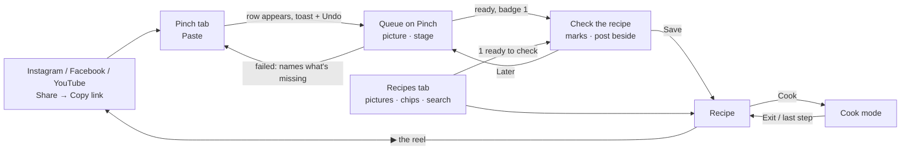

# UX pass 02 — the whole app, fresh eyes

2026-11-09, branch `ux-pass-02`, after U4, U2, M6 and M7 merged. Method:
`.claude/skills/design-studio/SKILL.md`. Evidence: `research.md` (A–C from pass 1, **D1–D4,
E1–E4 new**), the screenshots in `.metrics/ux/pass-02/` (git-ignored; script
`.metrics/ui/pass-02-shots.mjs`), and the user's own words.

## 1. Plan

**Focus (the user's answers).** The whole app, with the weight on what feels most wrong:
**pinching a reel** and **checking a draft**, and the user's note: *"it needs a clear diversion
between the input main field and the recipe library, maybe we need tabs; also we need an image
or thumbnail for each recipe that came from a link, to help the user remember what they
saved."* No Figma: designed from `plan.md` and the shipped U4 look.

**The problem.** The look (U4) and cook mode (U2) shipped, but the home is the same form with
a list under it that pass 1 found: at 360 px the first recipe starts ~1,000 px down
(`home-360-full.png`: heading, a 4-line textarea, Pinch it, screenshots, two dashed "Your
imports" boxes, search, then cards). The library and the capture compete on one page, so
neither is clear. No recipe in the household's data has a picture: the dev recipes predate M6
or were written by hand, and a card without a thumbnail is a bare title bar, so 14 of 14 cards
look the same. Review is still the recipe form (2,610 px for a 3-ingredient draft,
`review-360-full.png`) with nothing showing what the model read or doubted.

**Success signals** (measured on a phone, 360 px, in the built app):

1. **Copied link → "it's working" in 2 taps** (switch to Pinch, tap Paste; 3 on iOS Safari,
   whose own Paste bubble adds one, C17) and a row with its stage within 1 s, the post's
   picture within seconds; today 4–5 taps and a dashed box with a raw URL.
2. **The first recipe card is above the fold at 360 × 780** on the Recipes tab, with a picture
   or a cover on every card; today ~1,000 px down, 0 of 14 with a picture.
3. **Save is on screen at every scroll position of a draft**, and every field the model flagged
   is marked with its reason; today Save is 2,500 px down and nothing is marked.

**Out of scope.** The forms (U12 stays as proposed; no new wireframe), the PWA and share target
(U8, "later", plan §9 Q6), TikTok (§9 Q1), servings scaling (§9 Q3), Hebrew UI strings beyond
the recipe's own blocks (U11 covers the read view; a full Hebrew UI is a separate decision).

**What is real today** (`.metrics/ux/pass-02/`):

| Screen | What hurts | Shot |
|---|---|---|
| `/` | Form first; "Pinch it" and "Or add screenshots" stacked as two buttons; two imports with the same raw URL `https://youtu.be/abc` and no picture; cards are bars with no image | `home-360-full.png`, `home-1440-dark.png` |
| `/imports/:id` | The recipe form; 35 tag chips; Save at the bottom; the source a raw link | `review-360-full.png` |
| `/recipes/:id` | Edit / Share / Delete still in a row under Cook; a Hebrew recipe has English headings | `recipe-he-360-light.png` |
| `/recipes/:id/cook` | One 720 px column at 1440; "Step 1 of 8" left-aligned in English over a right-to-left step; "This browser may let the screen lock" in grey | `cook-he-1440-light.png` |

Good, keep: the tokens and dark theme read warm and finished; cook mode's big step and inline
ingredients work; every state is engineered (loading, error, focus, live regions).

## 2. Research

`research.md` § Pass 2: D1 Honeydew, D2 Plan to Eat, D3 NYT Cooking, D4 Tasty; E1 Shazam,
E2 Things 3, E3 Dext/Veryfi, E4 Pinterest + NN/g + cover fallbacks. The answers in one line
each: **tabs** — yes, two (D4, E1); **pinching** — the row appears at once with a stage (E1,
E2, B14); **checking** — the post beside the draft, doubt flagged per field (E3, C18, C19);
**pictures** — the post's picture, and a *literal* cover when there is none (E4 NN/g). The
analogues table in `plan.md` §4 gained four rows.

## 3. Personas and journeys

`plan.md` §2 updated (no new persona: the research shows no group Noa and Daniel miss). What
changed: Noa recognises recipes **by their picture**, not their name (D4, E4), so a card with
no picture is a recipe she can't find; Daniel plans on a **laptop on Thursday night**
`[ASSUMPTION]`, pastes several links at once and checks them side by side with the post. Each
now has an accessibility stretch (Noa: wet hands and the phone at arm's length; Daniel: Hebrew
and English recipes in one list, reading glasses at the counter).

**N1, pinch a reel — after this pass.** 1. Copy the link in Instagram. 2. Open Pinch, tap the
**Pinch** tab. 3. Tap **Paste**: the link is sent, a row with its stage appears (the reel's picture
a few seconds later), the toast says "Pinched. Making your recipe… Undo". **Breaks today at:** step 3 is four steps
(tap the box, long-press, Paste, find the button) and confirmation is a dashed box with a raw
URL (`home-360-light.png`).

**D1, trust the draft — after this pass.** 1. The Pinch tab's badge says 1; the row says "Ready
to check · 3 things to look at". 2. Check it: the draft as a recipe, the post's picture and
caption beside it (desktop) or folded above (phone), three yellow marks with reasons. 3. Tap the
garlic, pick "Use 4 (video)". 4. Save, always in reach. **Breaks today at:** every step — it
is a form, the caption isn't shown, nothing is marked, Save is at the bottom.

**N2, pick dinner — after this pass.** Open the app on Recipes: pictures above the fold, "quick"
first in the chips. **Breaks today at:** the form and the queue sit above the list.

## 4. Features

### In focus, mapped

| Feature | Persona · goal | State |
|---|---|---|
| Paste a link / text / screenshots | Noa N1 | built (M4–M6); moves to the Pinch tab |
| Import status with retry | Noa N1, Daniel D1 | built; becomes the Pinch tab's queue (U6) |
| Review a draft | Daniel D1 | built as a form; U3 redesigns it |
| Library, search, tag filters | Noa N2, Daniel D2 | built; U7 chips + sheet |
| Thumbnails | Noa N2 (recall) | built for links (M6); none for text/manual |
| Recipe page, Cook | Noa N3, Daniel D3 | built; desktop two-column missing |
| Cook mode | Noa N3, Daniel D3 | built (U2); two-column and RTL chrome missing |
| New recipe by hand | fallback (§1.7) | built; moves to ⋯ |

### Proposed new features (each fills a gap a persona or finding shows)

| # | Feature | Problem · evidence | Effort | MoSCoW |
|---|---|---|---|---|
| **U13** | **Two tabs: Recipes and Pinch.** Phone: a bottom bar; ≥ 768 px: segmented tabs in the header. Pinch holds the field, Paste, screenshots and the queue (U6); its badge counts drafts ready to check. Recipes is the default tab and shows a one-line "1 recipe ready to check" when one waits. Replaces U1's "capture bar on top of the library" | The user asked for a clear split; D4 Tasty and E1 Shazam split add from browse; today the form pushes the library ~1,000 px down | M (2 PRs: the frame and routes `/` + `/pinch`; then moving ImportForm/ImportList) | **Must** |
| **U14** | **A face for every recipe.** The post's picture when there is one; otherwise the dish's emoji on a cuisine tint. Gemini returns one `emoji` for the dish (schema + prompt); recipes without one get it from their tags (a fixed map, client-side) | The user asked for it; NN/g: literal, distinct, labelled (E4); 0 of 14 dev recipes have a picture | M (server+shared: 1 PR; client tile: 1 PR) | **Must** |
| **U15** | **Paste and go.** The Paste button reads the clipboard and sends at once (no second tap); desktop: ⌘V anywhere on the Pinch tab pinches | N1's taps (signal 1); C17; E2 "will just need a name" | S | **Should** |
| **U16** | **Two columns on wide screens** for the recipe and cook mode (ingredients beside steps), and the cook chrome in the recipe's direction | D3 Daniel; B4, B6; U2 proposed it and it wasn't built (`cook-he-1440-light.png`) | S–M (1–2 PRs) | **Should** |

Revised, already proposed: **U3** (review as checking) now has its wireframe (`check.html`)
and is the second **Must**; **U6** (queue strip with Undo) lives on the Pinch tab, not the home;
**U7** (chips + sheet) and **U10** (the source on the recipe) are **Should**; **U5** (cards with a
face) is absorbed by U14. **Could:** U11 (recipe in its own direction) — folded into U16 for
cook mode; U12 (shorter forms). **Won't, this milestone:** U8 (PWA), U9 (want to cook / cooked).

### Cut or simplify

- **"New recipe" in the header** → the ⋯ menu: manual entry serves no persona's main job
  (plan §7 surface closure); in the header it is as loud as the mark (m05 §6).
- **The "Your recipes" `h1`** → a visually hidden `h1`: the tab says where you are.
- **"Share · coming soon" as a button** → a row in the ⋯ menu: a disabled button in the main
  row is noise next to Cook (design §1 keeps the placeholder; it stays, quieter).
- **"Or add screenshots" as a second big button** → a quiet link under Pinch it: it is the
  fallback, not a peer.

## 5. Information architecture and responsive behaviour

### Screen inventory against design §14

| Address | §14 today | After this pass |
|---|---|---|
| `/` | Your recipes (box, imports, list) | **Recipes** tab: ready line, search, chips, grid |
| `/pinch` | — | **Pinch** tab (new): field, Paste, screenshots, queue |
| `/imports/:id` | Review the recipe (the form) | **Check the recipe**: preview + marks + sticky Save |
| `/recipes/:id` | A recipe | Same; ⋯ menu; picture or cover; two columns ≥ 1024 |
| `/recipes/:id/cook` | Cook mode | Same; two columns ≥ 1024; chrome in the recipe's direction |
| `/recipes/new`, `/edit` | forms | unchanged (U12 later); New reached from ⋯ |
| `*` | Not found | unchanged |

### Flows

### Per screen, by width

| Screen | 360 | 768 | 1024 | 1440 | Why |
|---|---|---|---|---|---|
| Frame | Header: mark + ⋯; **bottom tab bar** (68 px, two tabs) | Tabs move into the header as a segmented control; no bottom bar | same | same, content max 1200 px | Thumb reach on a phone (principle 3); a bottom bar on a tablet wastes height; D4/E1 |
| Recipes | 2-column grid, chips scroll sideways, search full width | 3 columns | 4 columns | 5 columns; search moves into the header | One focal point: pictures (E4). Primary action: open a card |
| Pinch | One column: field + Paste, Pinch it, the queue under it | one column, 560 px | two columns: capture left (480 px), queue right | same, ⌘V anywhere | Capture is short; on wide screens both are seen at once (Daniel pastes several) |
| Check | Source strip on top, draft, caption folded, **sticky Save bar at the bottom** | same, 640 px | two columns: post + caption left (360 px, sticky), draft right; Save top-right | same | Save in reach (B3); the source beside the fields (E3) |
| Recipe | Picture full width (5:4), Cook full width under the title | picture 4:5 beside the title | + ingredients panel beside steps | same | Cook is the one action; D3 two-column |
| Cook mode | One step, Back/Next at the bottom, timers above them | same, larger type | ingredients checklist left, step right | same | B4 Crouton iPad; knuckle targets (principle 3) |

## 6. Colour and visual foundations

`plan.md` §6 keeps the direction and every token; this pass **adds** eight, all checked:
`--color-check-soft`, `--color-check-mark`, `--color-danger-soft` and five cuisine tile tints (`--color-tile-tomato`,
`-saffron`, `-olive`, `-sea`, `-plum`). Swatches: `wireframes/palette.html`.

- **Tile tints** are the cover of a recipe with no picture (U14). Food colours from the pan,
  not from a UI kit: tomato (Italian, Mexican), saffron (Middle Eastern, Indian), olive
  (Mediterranean, salads), sea (Asian), plum (desserts, French, American). Light tints sit
  under ink; dark ones under the light ink, so a cover never looks like a button. They set
  Pinch apart from grey placeholders (D3, D4) and from Mela's single yellow (B5).
- **check-soft** is the "check this" field background; the yellow `check` stays a mark beside
  it, never text (it fails as text). **danger-soft** is a missing required field's background,
  with `danger` text and a ■ mark.
- **The active tab** is `accent-strong` on `accent-soft` (the selected chip's pair), so
  "where am I" uses the one accent the app already teaches.
- Neutrals 50–950 (warm stone) are documented on the palette page as the source the semantic
  tokens were picked from; they are not new tokens (styling.md: semantic names in components).
- Type, spacing, radii, shadow and motion: unchanged (§6). New uses: card titles 16 px display
  (two lines, clamped); the tab bar labels 12 px; the bottom bar 68 px tall.

`node .claude/skills/design-studio/contrast.mjs` (five tile tints were adjusted after the first
run, where muted text failed on tomato, sea, plum (light) and saffron, olive (dark)):

| Pair | Fg | Bg | Ratio | Needs | AA |
|---|---|---|---|---|---|
| L text on surface | #221A12 | #FBF8F2 | 16.18:1 | 4.5:1 | pass |
| L muted on surface | #6E6257 | #FBF8F2 | 5.58:1 | 4.5:1 | pass |
| L muted on raised | #6E6257 | #FFFFFF | 5.92:1 | 4.5:1 | pass |
| L muted on fill | #6E6257 | #EFE7DA | 4.82:1 | 4.5:1 | pass |
| L accent-strong on surface | #A33612 | #FBF8F2 | 6.40:1 | 4.5:1 | pass |
| L accent-strong on accent-soft (tab active) | #A33612 | #FBE7DF | 5.69:1 | 4.5:1 | pass |
| L on-accent on accent-strong (button, badge) | #FFFFFF | #A33612 | 6.79:1 | 4.5:1 | pass |
| L accent wordmark (large) | #C8471B | #FBF8F2 | 4.53:1 | 3:1 | pass |
| L text on check-soft | #221A12 | #FBF1D3 | 15.21:1 | 4.5:1 | pass |
| L check mark on surface (UI) | #8A6A00 | #FBF8F2 | 4.78:1 | 3:1 | pass |
| L danger on danger-soft | #B3261E | #FBE4E1 | 5.38:1 | 4.5:1 | pass |
| L danger on surface | #B3261E | #FBF8F2 | 6.17:1 | 4.5:1 | pass |
| L cooked on surface | #5E7A3A | #FBF8F2 | 4.58:1 | 4.5:1 | pass |
| L border-field on surface (UI) | #968979 | #FBF8F2 | 3.22:1 | 3:1 | pass |
| L text on tile-tomato | #221A12 | #F8E1D8 | 13.68:1 | 4.5:1 | pass |
| L muted on tile-tomato | #6E6257 | #F8E1D8 | 4.72:1 | 4.5:1 | pass |
| L text on tile-saffron | #221A12 | #F5E3B8 | 13.53:1 | 4.5:1 | pass |
| L muted on tile-saffron | #6E6257 | #F5E3B8 | 4.67:1 | 4.5:1 | pass |
| L text on tile-olive | #221A12 | #DDE5C8 | 13.16:1 | 4.5:1 | pass |
| L muted on tile-olive | #6E6257 | #DDE5C8 | 4.54:1 | 4.5:1 | pass |
| L text on tile-sea | #221A12 | #DCE9E9 | 13.78:1 | 4.5:1 | pass |
| L muted on tile-sea | #6E6257 | #DCE9E9 | 4.76:1 | 4.5:1 | pass |
| L text on tile-plum | #221A12 | #EEE2EA | 13.64:1 | 4.5:1 | pass |
| L muted on tile-plum | #6E6257 | #EEE2EA | 4.71:1 | 4.5:1 | pass |
| D text on surface | #F3EDE4 | #17130F | 15.88:1 | 4.5:1 | pass |
| D muted on surface | #A89C8F | #17130F | 6.88:1 | 4.5:1 | pass |
| D muted on raised | #A89C8F | #221C16 | 6.28:1 | 4.5:1 | pass |
| D muted on fill | #A89C8F | #2C241D | 5.68:1 | 4.5:1 | pass |
| D accent-strong on surface | #F0693A | #17130F | 5.97:1 | 4.5:1 | pass |
| D accent-strong on accent-soft (tab active) | #F0693A | #3A1D12 | 4.97:1 | 4.5:1 | pass |
| D on-accent on accent-strong | #17130F | #F0693A | 5.97:1 | 4.5:1 | pass |
| D text on check-soft | #F3EDE4 | #3A2F12 | 11.31:1 | 4.5:1 | pass |
| D check mark on surface (UI) | #F2C94C | #17130F | 11.65:1 | 3:1 | pass |
| D danger on danger-soft | #F2706A | #3D1715 | 5.48:1 | 4.5:1 | pass |
| D danger on surface | #F2706A | #17130F | 6.42:1 | 4.5:1 | pass |
| D cooked on surface | #8FB35E | #17130F | 7.72:1 | 4.5:1 | pass |
| D border-field on surface (UI) | #76695D | #17130F | 3.47:1 | 3:1 | pass |
| D text on tile-tomato | #F3EDE4 | #4A2419 | 11.59:1 | 4.5:1 | pass |
| D muted on tile-tomato | #A89C8F | #4A2419 | 5.02:1 | 4.5:1 | pass |
| D text on tile-saffron | #F3EDE4 | #3E2F16 | 11.12:1 | 4.5:1 | pass |
| D muted on tile-saffron | #A89C8F | #3E2F16 | 4.82:1 | 4.5:1 | pass |
| D text on tile-olive | #F3EDE4 | #29331A | 11.40:1 | 4.5:1 | pass |
| D muted on tile-olive | #A89C8F | #29331A | 4.94:1 | 4.5:1 | pass |
| D text on tile-sea | #F3EDE4 | #1E3436 | 11.28:1 | 4.5:1 | pass |
| D muted on tile-sea | #A89C8F | #1E3436 | 4.89:1 | 4.5:1 | pass |
| D text on tile-plum | #F3EDE4 | #3B2434 | 12.13:1 | 4.5:1 | pass |
| D muted on tile-plum | #A89C8F | #3B2434 | 5.25:1 | 4.5:1 | pass |

Added after the review (pairs the wireframes use that the first table missed):

| Pair | Fg | Bg | Ratio | Needs | AA |
|---|---|---|---|---|---|
| L "Check it" ink on check-soft | #221A12 | #FBF1D3 | 15.21:1 | 4.5:1 | pass |
| D "Check it" ink on check-soft | #F3EDE4 | #3A2F12 | 11.31:1 | 4.5:1 | pass |
| L check-mark glyph/border on check-soft (UI) | #8A6A00 | #FBF1D3 | 4.50:1 | 3:1 | pass |
| D check-mark glyph/border on check-soft (UI) | #F2C94C | #3A2F12 | 8.30:1 | 3:1 | pass |
| L muted reason on check-soft | #6E6257 | #FBF1D3 | 5.25:1 | 4.5:1 | pass |
| D muted reason on check-soft | #A89C8F | #3A2F12 | 4.90:1 | 4.5:1 | pass |
| L active tab label on raised | #A33612 | #FFFFFF | 6.79:1 | 4.5:1 | pass |
| D active tab label on raised | #F0693A | #221C16 | 5.45:1 | 4.5:1 | pass |
| L inactive tab label on raised | #6E6257 | #FFFFFF | 5.92:1 | 4.5:1 | pass |
| D inactive tab label on raised | #A89C8F | #221C16 | 6.28:1 | 4.5:1 | pass |
| L platform glyph ink on white chip | #221A12 | #FFFFFF | 17.15:1 | 4.5:1 | pass |

Rule from this: the ready line's "Check it ›" is **ink, underlined**, not accent: dark accent
on dark `check-soft` is 4.25:1 and fails. The check mark's glyph and border use
`check-mark`, never the `check` fill (1.74:1 as a border on paper).

The light "check mark" pair uses `#8A6A00`, a darker yellow for the ◆ glyph only (the
`check` fill `#E8B931` is 1.9:1 on paper: a fill, never a glyph alone). Proposed as
`--color-check-mark`.

## 7. Wireframes

Each file: phone 360 and desktop 1440 side by side, numbered callouts explained under the
frames, the §14 states as extra frames. Shots in `wireframes/shots/`.

| File | Screen | States |
|---|---|---|
| `wireframes/library.html` | Recipes tab | default, loading, empty, no match, error |
| `wireframes/pinch.html` | Pinch tab | queue (making, ready, failed) + toast, empty, invalid link, daily cap |
| `wireframes/check.html` | Check the recipe | marks, field sheet, partial draft, loading, not ready |
| `wireframes/recipe.html` | A recipe (Hebrew phone, English desktop) | loading, no picture, not found, error |
| `wireframes/cook.html` | Cook mode (Hebrew phone, desktop two columns) | states unchanged from U2 |
| `wireframes/library-hifi.html` | **High fidelity:** Recipes tab in the tokens, light + dark phone, light desktop | — |
| `wireframes/palette.html` | Tokens, tile tints, type | — |

## 8. Decision log

| Decision | Options considered | Choice | Why (evidence) | Risk / open question |
|---|---|---|---|---|
| Split add from browse | Capture bar on top of the library (U1); a floating + opening a sheet; **two tabs** | Two tabs, Recipes and Pinch | The user asked; D4 Tasty, E1 Shazam; a bar keeps the form on the home | Two tabs is a bar for two items; revisit if a third (Plan, Shopping) arrives |
| Which tab opens first *(superseded, §12)* | **Recipes**; Pinch (Shazam's capture-first home, E1) | Recipes | Principle 2 "the library is the home"; N2 at 18:40 is the heavier visit; Pinch is one tap away and shows a badge | Noa arriving with a copied link pays one tap; test it (question 1) |
| Where the queue lives | On the home (today); **on the Pinch tab**; its own Inbox tab (E2 Things) | Pinch tab + a one-line "ready" link on Recipes | Capture and its results together (E1); a third tab for 0–3 items is too much | A ready draft can be missed if the line is ignored; the badge is the backstop |
| Paste behaviour | Paste fills the field; **Paste sends** | Paste sends (U15) | Saves a tap (signal 1); Undo in the toast is the way out (C5) | A wrong clipboard is sent; the URL check refuses non-links before sending |
| No-picture cover | Grey placeholder; title-on-colour (dev.to, E4); cuisine emoji; **the dish's own emoji on a cuisine tint** | Dish emoji from Gemini, cuisine emoji fallback | NN/g: literal and distinct (E4); 8 Italian dishes with 🍝 would all look alike | Emoji render differently per OS; Gemini may pick oddly — the review can change it |
| Review layout | The form (today); **the recipe preview with marks**; a two-step wizard | Preview + marks + tap-to-edit sheet | B5 Mela, E3 Dext, C18–C19; D1 Daniel | Needs `uncertain` from the model (U3 PR 2) and a caption kept on the import |
| Desktop tabs | Left sidebar (E2); **segmented tabs in the header** | Header tabs | Two destinations don't need a sidebar's width; the search fits the same row | — |
| New tokens | Raw hex in components; **semantic tokens** | 7 new semantic tokens + `check-mark` | styling.md; all AA (§6) | — |

**Proposed for `system-design.md` §10** (for the user to accept; written there through `/ship`):

- **D24** — Two tabs, Add a recipe (`/`, the default) and My recipes (`/recipes`); the
  import queue sits under the box on Add a recipe. Rejected: the capture bar on the library
  home (U1); Recipes as the default tab (revision 1, §12).
- **D25** — Every recipe has a face: the post's picture, else an emoji the model picks for the
  dish (a new optional `emoji` on the recipe and draft, Zod), on a cuisine tint. Rejected: grey
  placeholders; generated images.
- §14 rewritten for `/`, `/pinch`, `/imports/:id`, and §1 item 3 ("draft and review") gains
  "with the fields the model was unsure of marked".

## 9. Review

A fresh reviewer (Fable, no prior context) read the pass, the plan, ui-craft and every shot;
20 findings, all fixed except where noted:

- **Fixed, Must:** plan.md principle 2, §7 IA, states and surface closure, and §6 Imagery
  still described the capture bar — rewritten for the tabs; the default library frames showed
  "quick" as applied — now at rest, applied chips carry ✓ and ✕; two filled buttons on the
  Pinch tab — the ready row is now a tinted link ("Check it ›"), Pinch it the one primary; the
  daily-limit frame hid the field — it keeps the link in it; the partial draft's Save was
  greyed — full strength, focus to the first missing field; manual entry had no way in on
  desktop — ⋯ at the header's end on every width.
- **Fixed, Should:** contrast rows for check-soft, the mark and the tabs (above; one dark pair
  avoided); check-mark on the palette; card titles 16 px everywhere; chips 40 px with a 44 px
  hit area, the tab bar 68 px; the check count is 3 (olive oil had no amount); the desktop
  popover prefilled with the draft's value; visible labels in the field sheet and popover;
  Cancel removed from the making row (Undo in the toast is the one way back); Retry back on a
  failed fetch, "Paste its text" on "no recipe"; signal 1 states iOS's extra tap; a
  couldn't-send frame on Pinch, and the queue and Check errors named.
- **Fixed, Nice:** the tab bar in every library frame; Check's skeleton has the source strip's
  shape; Discard in ⋯ on desktop too; tags on the phone recipe; the cook "Next:" preview on
  phone; Cook on the right in an RTL recipe; the quota shown only from 15 used; emoji covers at
  64 px; the palette's neutral labels.
- **Kept, with a reason:** the toast *and* the row both confirm a pinch — the user named "no
  confirmation" as a pain, and the toast carries the only Undo.

## 10. Questions worth testing with real users

1. With a link copied, does Noa find the Pinch tab without looking, and does a library-first
   home cost her more than one tap? (Decision 2.)
2. Shown 12 cards, half with a post picture and half with an emoji cover, can she pick "the
   shakshuka I saved last week" as fast from either? (U14, E4.)
3. On a real draft with two marks, does Daniel trust the save more with the post beside it, and
   does anyone read "What the post said" on a phone?

## 11. First `/ship` slice

**U13 PR 1 — the frame:** the bottom tab bar (phone) and header tabs (≥ 768), a `/pinch` route
that renders today's ImportForm + ScreenshotsUpload + ImportList unchanged, Recipes on `/`
without them, and the badge from the imports query. No new components beyond the tab bar; no
server change; design §14 and D24 updated in the same PR. Then U14 (the face), then U3.

## 12. Revision 1: the user's sketch (2026-11-09)

The user drew the home and asked for its layout, keeping the first draft's elements (text,
buttons, tags, search, settings), and for shadcn/ui components even in the wireframes.
Wireframe: [`wireframes/home.html`](wireframes/home.html) (shot: `wireframes/shots/home.png`).
It **supersedes the frame and tab placement** in `library.html`, `pinch.html` and
`library-hifi.html`. Their cards, chips, search and states still hold.

| Decision | Options considered | Choice | Why (evidence) | Risk / open question |
|---|---|---|---|---|
| Which tab opens first | Recipes (first draft); **Add a recipe** | Add a recipe | The user, as product owner: "the main event of the app, so it always be first". It matches E1 Shazam's capture-first home, and Noa's moment of truth is the pinch | Daniel at 18:40 pays one tap to reach his recipes. Test question 1 now asks about the reverse case |
| Tab names | Recipes / Pinch; **Add a recipe / My recipes** | The sketch's names | Plain verbs and nouns; "Pinch" as a tab name needed learning | "Pinch it" is still the button, so the brand verb survives |
| Tabs on a phone | Bottom bar (first draft); **a row under the header** | Under the header, full width, 44 px | The sketch puts them at the top. At 360 px the mark, the tabs and the avatar don't fit on one line, so the tabs get their own row | The top row is out of thumb reach (principle 3). Tab switches are rare next to Pinch it and Review, which sit in the middle of the screen |
| The ⋯ menu | ⋯ in the header; **the avatar's menu** | Avatar | The sketch's circle → Login. One place for account and rare actions | Before auth (D13) the avatar is a generic icon, not a person |
| Still-cooking card | Disabled Review (as drawn, crossed out); **no button: spinner + "usually under a minute"** | No button | ui-craft: don't show an action that can't be taken. The sketch crossed Review out | — |
| Thumbnail source | A frame Gemini picks (the sketch's note); **the post's cover from yt-dlp** | Cover | Already design §5: the picture the author chose, one path for all three platforms. A Gemini-chosen frame is a later option if covers prove poor | Facebook covers are sometimes a title card |
| Components | Pinch's own (Button, TextField today); **shadcn/ui** | shadcn/ui, its CSS variables mapped onto Pinch's tokens | The user's call. Accessible Radix parts (Tabs, DropdownMenu, Sheet for the check screen), and the code lives in the repo, so it stays readable | **A stack change: proposed as D26.** It adds Radix, `class-variance-authority` and `tailwind-merge`. shadcn's 36 px controls are raised to 44 px for touch |

**Accepted (2026-11-09), in `system-design.md` §10 as D24–D26:**

- **D26**: the UI is built from shadcn/ui components, copied into `client/src/components/ui/`.
  Their variables (`--background`, `--primary`, …) map onto the tokens in plan.md §6, and the
  touch sizes are 44 px. Today's `Button` and `TextField` are replaced, not kept beside them
  (one pattern per problem). Rejected: our own components only, and a packaged kit (MUI,
  Chakra) whose code the user can't read.

**First `/ship` slice, revised:** D26 setup first (shadcn init, the token mapping, Button,
Input, Tabs). Then U13 PR 1: the header (mark + avatar), the two tabs, `/` = Add a recipe
(today's ImportForm + ImportList moved under the box), `/recipes` = My recipes.

**Contrast of the pairs this revision adds** (borders and the ◆ glyph are UI, 3:1):

| Pair | Fg | Bg | Ratio | Needs | AA |
|---|---|---|---|---|---|
| field/outline border, light (UI) | #968979 | #FFFFFF | 3.41:1 | 3:1 | pass |
| field border on page, light (UI) | #968979 | #FBF8F2 | 3.22:1 | 3:1 | pass |
| field border, dark (UI) | #6E6257 | #17130F | 3.12:1 | 3:1 | pass |
| ◆ check-mark on check-soft, light (UI glyph) | #8A6A00 | #FBF1D3 | 4.50:1 | 3:1 | pass |
| meta text on check-soft, light | #6E6257 | #FBF1D3 | 5.25:1 | 4.5:1 | pass |
| ink on check-soft, light | #221A12 | #FBF1D3 | 15.21:1 | 4.5:1 | pass |
| meta text on check-soft, dark | #A89C8F | #3A2F12 | 4.90:1 | 4.5:1 | pass |
| active tab text, light | #A33612 | #FBF8F2 | 6.40:1 | 4.5:1 | pass |
| active tab text, dark | #F0693A | #17130F | 5.97:1 | 4.5:1 | pass |
| inactive tab text on muted, light | #6E6257 | #EFE7DA | 4.82:1 | 4.5:1 | pass |
| inactive tab text on muted, dark | #A89C8F | #2C241D | 5.68:1 | 4.5:1 | pass |
| badge text on primary, dark | #17130F | #F0693A | 5.97:1 | 4.5:1 | pass |
| failed reason, light | #B3261E | #FFFFFF | 6.54:1 | 4.5:1 | pass |
| failed reason, dark | #F2706A | #221C16 | 5.86:1 | 4.5:1 | pass |

## 13. Revision 2: the user's review (2026-11-09)

**UX only**: colour is set aside, so the wireframes use shadcn's own neutral theme. The new
wireframes replace `library`, `pinch`, `check` and `library-hifi`, which are kept with a banner.

| File | What it shows |
|---|---|
| [`home.html`](wireframes/home.html) | The **New recipe** tab: the input, the queue, the field growing, first visit, and every toast |
| [`recipes.html`](wireframes/recipes.html) | The **My recipes** tab: search, tag chips, Filters (a phone sheet, a desktop panel), no matches, empty, loading |
| [`recipe.html`](wireframes/recipe.html) | A recipe, with breadcrumbs and the source in the subtitle |
| [`cook.html`](wireframes/cook.html) | Cook mode: swiping between steps, no Exit, the source in the subtitle |
| [`edit.html`](wireframes/edit.html) | **One editor for three jobs**: review a draft, write by hand, edit a saved recipe |

| Change (the user's words) | How the design takes it | Why / risk |
|---|---|---|
| "Add a Recipe" → **New recipe** | The tab's name | — |
| "Write a recipe by hand" on both tabs, not in the profile menu | Phone: a floating outline button, bottom right, on both tabs. Desktop: in the header | Thumb reach, and the same place on every tab. It's an outline button, so Pinch it stays the one filled one. *Risk:* it can cover a card's last line; the list gets 96 px of padding at the bottom |
| An **Input**, not a textarea; it grows when the text no longer fits; on a phone, a short placeholder with an ellipsis | An input group (Paste · input · Pinch it) that becomes an auto-sized textarea (up to 6 lines) once the text wraps | A link never wraps, so a link paste stays one line |
| Cooking: the spinner in a **disabled button** | "◌ Cooking…" in the button's place, which becomes Review when the draft is ready | The action's place is learned before it can be used |
| Remove the logo for now | The header is the tabs and the avatar | — |
| A toast for **every async status change** | Seven events, each with its next step (table in home.html). Toasts sit at the top on a phone and bottom right on desktop | A change that happens elsewhere (ready, failed) toasts on whatever page you're on |
| My recipes with filters and tags | Chips = the household's five most-used tags; Filters = Sort, Time, Source, then the five facets from design §7. Phone: a bottom sheet with a live "Show N recipes". Desktop: a left panel with per-value counts. Filters live in the URL | The counts stop someone filtering into an empty grid |
| Cook: swipe on a phone; source in the subtitle; no Exit; **breadcrumbs everywhere** | A Carousel (snaps, the next card peeks), with ‹ › kept around the dots. Breadcrumbs on every inner page; the owning tab stays selected | Swipe alone fails WCAG 2.5.7 and wet hands, so the buttons stay. *Open:* is the tab row worth its 56 px in cook mode? |
| A better edit page for AI drafts and hand-written recipes | One page: same fields, different top (a draft banner / a "paste it instead" tip), ◆ marks only on drafts, a Save bar pinned to the bottom. Ingredients as amount · unit · name rows (the schema's own shape), with Paste a list | One pattern instead of two forms. Review (`/imports/:id`) and write/edit (`/recipes/new`, `/:id/edit`) share one component |

**Routes after this revision:** `/` New recipe · `/recipes` My recipes (filters in the query) ·
`/recipes/:id` · `/recipes/:id/cook` · `/recipes/:id/edit` · `/recipes/new` (breadcrumb under
New recipe) · `/imports/:id` (review).

**Accepted 2026-11-09.** D24–D26 and §14 are in `docs/system-design.md`; the build is M8 in
`docs/progress.md` (R1–R8 the UI on today's API, then F1–F4 the features it asks the API for).
